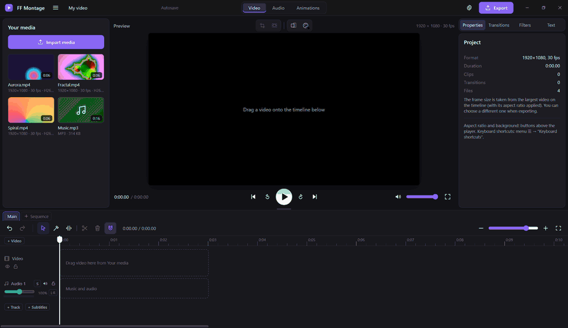

<p align="center">
  
</p>

<h1 align="center">FF Montage</h1>
<h3 align="center">A free, open-source video editor with FFmpeg under the hood.</h3>

<div align="center">



<p align="center">
  <a href="https://github.com/IsselSaizo/FFMontage/releases/latest"></a>
  <a href="https://github.com/IsselSaizo/FFMontage/releases"></a>
  <a href="https://github.com/IsselSaizo/FFMontage/actions/workflows/ci.yml"></a>
  <a href="#download"></a>
  <a href="LICENSE"></a>
</p>

<p align="center">
  <a href="https://github.com/IsselSaizo/FFMontage/releases/latest"></a>
</p>

**🇬🇧 English** · [🇷🇺 Русский](docs/ReadMEs/README.ru.md) · [🇩🇪 Deutsch](docs/ReadMEs/README.de.md) · [🇨🇳 简体中文](docs/ReadMEs/README.zh-Hans.md) · [🇯🇵 日本語](docs/ReadMEs/README.ja.md)

</div>

## About

FF Montage is a free, open-source video editor for Windows, Linux and the Steam Deck. The preview plays your
footage as it is, and the finished video is put together by **FFmpeg**: in the source resolution and frame rate
(1440p60 stays 1440p60), in AV1, HEVC or H.264, on your graphics card (NVIDIA NVENC, Intel QSV, AMD AMF, VA-API on
Linux) when there is one, on the CPU when there is not.

No watermark, no account, no subscription, no upload. Everything runs on your machine: the program is a single
file built on [Tauri 2](https://tauri.app) (Rust + the system WebView), and FFmpeg sits next to it.

**Good for:** YouTube videos and game clips (NVIDIA / OBS recordings with several audio tracks open as they are),
Shorts / Reels / TikTok in 9:16, tutorials and screen recordings, interviews and podcasts, subtitled videos,
broadcast masters.

**Also for machines:** a built-in MCP server lets Claude, Cursor and other AI assistants edit for you, and a
sandboxed plugin API lets anyone add effects, transitions, panels and presets.

Version 0.4.7. What's new: [CHANGELOG.md](CHANGELOG.md) (in Russian).

## Highlights

- 🚫 **No watermark. No account. No paywall.** Free software under GPL-3.0.
- 🔒 **100% local.** Nothing is uploaded; works offline. The AI assistant only talks to the program on this computer.
- ⚡ **FFmpeg export on the GPU.** NVENC, QSV, AMF, VA-API, or the CPU. AV1, HEVC, H.264, up to the source resolution and frame rate.
- 🎞️ **Opens what you record.** H.264, HEVC and AV1 play without conversion; MKV, TS, AVI and the rest are remuxed or proxied automatically.
- ✂️ **Real editing tools.** Blade, ripple / roll / slip / slide trims, In / Out marks, lift / extract, JKL shuttle, magnetic timeline.
- 🧱 **Multi-track.** Video tracks as layers with transform and crop, any number of audio tracks, subtitle tracks, several timelines (episodes) in one project.
- 📝 **Titles and subtitles.** Text that looks the same in the preview and the export; SRT / VTT / ASS import and export.
- 🎚️ **Proper sound.** EQ, compressor, denoise, VST3 and CLAP plugins, level meters, two-pass loudness normalisation, 5.1 / 7.1 / N mono channels.
- 📤 **Many formats.** MP4, MKV, MOV, GIF, MP3, M4A, WAV, OGG, plus ProRes / DNxHR / XDCAM masters with timecode.
- 🧩 **Plugins.** Effects, transitions, text styles, export and hotkey presets, actions and panels, all in a sandbox.
- 🤖 **AI assistant (MCP).** Ask Claude to cut out the pauses, put music under the video and export it in 1080p.
- ⌨️ **Your hotkeys.** Presets for Premiere Pro, DaVinci Resolve and CapCut, plus your own shortcuts; gamepad and touch on the Steam Deck.
- 🌍 **English and Russian interface**, switched without a restart.

## Features

### Media
- Import with a button or drag-and-drop. **H.264, HEVC and AV1** open without conversion when the WebView can decode
  them; the program asks the WebView itself instead of guessing.
- **MKV, TS, M2TS, AVI** and other containers: if the codec plays, the stream is remuxed into MP4 without re-encoding
  (seconds, source quality); otherwise a 720p proxy is made. **The export always uses the original file.**
- Recordings with **several audio streams** (game + microphone from NVIDIA ShadowPlay / OBS): every stream lands on its
  own linked audio clip.
- Images (JPG, PNG, WebP, BMP) and animated GIFs.

### Timeline
- Move, trim by the edges, split (`S`, `Alt+S` splits everything under the playhead), blade (`B`, `Shift`+click cuts
  all tracks), magnet, overwrite and insert (`Alt`), gaps and closing gaps, undo / redo, zoom.
- **Trim tool (`T`)**: the edge of a clip is a **ripple**, the seam between two clips a **roll**, the lower half a
  **slip**, the upper half a **slide**. The preview shows both frames around the edit.
- **In / Out marks** (`I` / `O`), **lift** (`;`) and **extract** (`'`), trim to playhead (`Q` / `W`).
- **JKL shuttle**: `L` plays forward ×1 → ×2 → ×4 → ×8, `J` backwards, `K` stops; `K` + `J` / `L` steps a frame.
- **Remove pauses…**: silent parts (FFmpeg `silencedetect`) are cut out together with the video, everything else moves up.
- **Episodes**: several timelines in one project.
- Mouse: wheel scrolls in time, `Shift` + wheel scrolls the tracks, `Ctrl` + wheel zooms.

### Video
- **Several video tracks**: the order sets the layers; every track can be hidden or locked.
- **Transform**: position, scale, rotation, opacity — with a gizmo right in the player (snaps to the centre and the
  edges) or with fields in the inspector. **Crop** with a frame in the player.
- **Speed** ×0.1–×16 (the pitch is kept), reverse, freeze frame.
- **20 transitions** (0.1–3 s), **filters** (black & white, sepia, contrast, blur…), **frame formats** 16:9, 9:16, 1:1,
  3:4 with a background, fit / fill / stretch.
- **Animations** tab: the “Rain” preset with a live preview, baked into a WebM with transparency.
- Picture-in-picture and grid layouts — the example plugin `examples/plugins/layouts`.

### Text and subtitles
- Title, lower third, caption, rolling credits, plain text. Font, colour, outline, shadow, background plate, alignment.
- Inter and Open Sans are built in (with Cyrillic); your own `.ttf` / `.otf` fonts are added in the program.
  **The text looks the same in the player and in the finished video.**
- **Subtitle tracks**: import and save SRT / VTT / ASS (encoding from the BOM, else UTF-8, else cp1251), edit lines on
  the timeline. Export: burned in (libass) or as a separate stream.

### Sound
- Video sound as separate linked clips, music and voice tracks, clip and track volume 0–200 %, solo, mute, lock, fades.
- **Audio** tab: equaliser, compressor and denoise on a clip or a whole track. **VST3 and CLAP plugins** (Windows x64)
  in the same rack; the plugin window opens separately, a crashing plugin does not take the program down.
- **Level meters** on every track and for the whole mix (red above −1 dBFS).
- **Loudness normalisation** in two passes: “Web −14 LUFS”, “Podcast −16 LUFS”, “Broadcast −23 LUFS (EBU R128)”.
- **Multichannel projects**: stereo, mono, 5.1, 7.1 or up to 16 separate mono channels; routing matrix
  “track → channels”, “Split into channels” for multichannel clips; the player listens to a stereo downmix.

### Export
- Video: **MP4, MKV, MOV, GIF**; audio only: **MP3, M4A, WAV, OGG**. Resolution from 480p up to the source,
  progress and cancel, the full FFmpeg command in `<cache>/app/logs/last-export.log`.
- **AV1, HEVC, H.264** on NVIDIA NVENC, Intel QSV, AMD AMF, VA-API, or on the CPU (SVT-AV1, x265, x264).
- MKV and MOV can carry **every audio track as its own stream** (the mix first, then each track by name).
- **Master file**: Apple ProRes 422 / HQ / 4444, Avid DNxHR SQ / HQ / HQX, Sony XDCAM HD422 (MXF), 24-bit PCM,
  start **timecode** (drop-frame where needed).
- Every FFmpeg command is checked in Rust before it runs: inputs only from the project, output only to the file you chose.

### Plugins
- A plugin is a folder with `plugin.json`: **effects, transitions, audio effects, text styles, export and hotkey
  presets, loudness targets, actions and panels**. The built-in effects are a plugin (`core`) on the same API.
- Plugins run in a sandbox (an iframe with no access to the program, the files or FFmpeg). Effects describe FFmpeg
  filters declaratively; only whitelisted filters pass, and Rust checks the whole graph again.
- Install from a folder, a zip or straight from GitHub (`owner/repo`, SHA-256 checked); permissions are shown before
  installing. Guide: [docs/Guides/PLUGINS.md](docs/Guides/PLUGINS.md), examples: [`examples/plugins`](examples/plugins).

### Everything else
- **Hotkeys** with presets “Default / DaVinci Resolve / Premiere Pro / CapCut”, your own shortcuts on top, conflict
  search, JSON export and import — full table in [docs/Guides/HOTKEYS.md](docs/Guides/HOTKEYS.md).
- **Steam Deck**: gamepad controls (A — play, X — split, B — undo, LB / RB — frames, LT / RT — shuttle…), touch-friendly
  handles, a 1280×800 layout.
- Autosave, projects in a single `.ffproj` file, portable mode, signed updates from inside the program.
- **Crash reports** stay on your disk (`logs/reports`), nothing is sent anywhere.

## Download

| | Windows | Linux |
|---|---|---|
| System | Windows 10 / 11 x64 | x86_64, glibc 2.35+ (Ubuntu 22.04+, Arch, SteamOS) |
| Window | WebView2 (in Windows 11 and an updated 10) | WebKitGTK 4.1, GStreamer good (sound and video in the preview) |
| FFmpeg | inside the release archive | inside the release archive / AppImage |
| Screen | 1280×800 or more | 1280×800 or more |

macOS and ARM are not supported yet (planned, see the [ROADMAP](docs/Works/ROADMAP.md)).

### Ready-made build

1. Open **[Releases](https://github.com/IsselSaizo/FFMontage/releases/latest)** and download
   `FF-Montage-<version>-windows-x64.zip` (Windows) or `FF-Montage-<version>-linux-x86_64.tar.gz` (Linux; on the
   Steam Deck and other distributions the AppImage below is easier).
2. Unpack it into any folder you can write to (for example `D:\FF Montage`).
3. Run **`FF Montage.exe`** (Linux: `./ff-montage`). FFmpeg is already in the archive.

Windows may say “Windows protected your PC”: click **More info** › **Run anyway** (the program has no code-signing
certificate).
Linux: `sudo apt install libwebkit2gtk-4.1-0 gstreamer1.0-plugins-good` (Ubuntu 22.04+),
Arch: `sudo pacman -S webkit2gtk-4.1 gst-plugins-good`.

**Where the data lives.** The Windows zip build in a writable folder runs in **portable mode**: settings, your fonts,
plugins and the cache sit next to the program, and the folder can be moved as a whole. Otherwise (Linux, a read-only
folder, Program Files) system folders are used: Windows — `%APPDATA%\FF Montage` and `%LOCALAPPDATA%\FF Montage`,
Linux — `~/.config/ff-montage`, `~/.local/share/ff-montage`, `~/.cache/ff-montage`.
Portable mode can also be forced: a `portable.txt` file next to the program or `FFM_PORTABLE=1`
(`FFM_PORTABLE=0` turns it off). The current paths are in **Settings → About**.

**Updates:** menu ☰ → **Check for updates…**. The program downloads the archive for your system from the latest
release and installs it only if the `SHA256SUMS` signature is valid and the archive's SHA-256 matches. Settings and
projects are not touched. To check files by hand: `sha256sum -c SHA256SUMS --ignore-missing`.

### Linux and Steam Deck: AppImage

`FF-Montage-<version>-linux-x86_64.AppImage` is one file with everything inside: the window (WebKitGTK), GStreamer
for video and sound in the player, and FFmpeg. Nothing to install, no `sudo`.

1. Download the AppImage from [Releases](https://github.com/IsselSaizo/FFMontage/releases/latest), e.g. into `~/Applications`.
2. Make it executable: `chmod +x FF-Montage-*.AppImage` (or in Dolphin: right-click → Properties → Permissions →
   Is executable).
3. Run it with a double-click or `./FF-Montage-<version>-linux-x86_64.AppImage`.

**Steam Deck.** **Desktop mode** is the most comfortable (power button → Switch to Desktop): there is a keyboard,
mouse / touchpad, and files are visible in Dolphin. To start it from Game mode: Steam (on the desktop) → Games →
Add a Non-Steam Game to My Library… → Browse… → pick the AppImage (filter “All files”) → Add Selected Programs.
The window is designed for 1280×800; in Game mode use the on-screen keyboard (Steam + X) or a connected keyboard for
text and hotkeys.

- Data lives in the XDG folders (`~/.config/ff-montage`, `~/.local/share/ff-montage`, `~/.cache/ff-montage`): the
  AppImage itself is read-only. Cache, export and project folders are chosen on first launch (an SD card works well on the Deck).
- **Updating** (Check for updates…) downloads the new AppImage, checks the signature and SHA-256 and replaces
  **the same file** (the name stays, so the Steam shortcut keeps working). The AppImage folder must be writable.
- If the AppImage does not start because of FUSE (SteamOS has it, some systems do not):
  `./FF-Montage-….AppImage --appimage-extract-and-run`, or install `libfuse2`.
- Diagnostics: `./FF-Montage-….AppImage --engine info </dev/null` shows where FFmpeg comes from, which GStreamer
  plugins were found and where the data is written.
- Hardware export on the Deck is VA-API (`h264_vaapi`, `hevc_vaapi`); the Deck's GPU cannot encode AV1, so AV1 goes to the CPU.

### From source

```powershell
git clone https://github.com/IsselSaizo/FFMontage.git
cd FFMontage
.\setup.cmd          # Linux: ./setup.sh
```

`setup` downloads FFmpeg into `ffmpeg\` (a pinned build, SHA-256 checked), installs Rust (on Windows, if needed,
Visual Studio Build Tools via winget), builds the program into **`FF Montage.exe`** and puts a shortcut on the
desktop. The first build takes 3–6 minutes. In a git clone, Check for updates… runs `git pull` and rebuilds.

- FFmpeg already installed: `.\setup.cmd -SkipFFmpeg`. Its folder can be chosen on first launch.
- Without a graphics card the export runs on the CPU (libsvtav1 / libx265 / libx264): slower, same result.

## First launch

The program asks for its folders:

| Folder | What goes there |
|---|---|
| **Cache** | thumbnails, waveforms, proxies, window data, autosave, logs |
| **Export** | finished videos |
| **Projects** | `.ffproj` files |
| **FFmpeg** | can stay empty: the program finds it itself (an `ffmpeg` folder next to the program, neighbouring `ffmpeg-*` folders, `PATH`) |

The folders are stored in `config.json`, interface settings in `settings.json` (both in the settings folder, see
“Where the data lives”). Change the folders in **Settings → Folders**; deleting `config.json` brings the first-launch
window back.

## Settings

Menu ☰ → **Settings…** (`Ctrl+,`):

- **General** — language (English / Russian), whether to reopen the last project on start.
- **Keyboard shortcuts** — preset, your own shortcuts, search, conflicts, JSON export and import.
- **Plugins** — install from a folder, a zip or GitHub; enable, permissions, remove.
- **Audio plugins (VST3, CLAP)** — folders, scan, add a plugin.
- **Folders**, **Cache** (sizes, clearing by category, a size limit), **AI assistant**, **About** (versions, paths,
  updates, crash reports).

## AI assistant (MCP)

FF Montage connects to AI assistants over MCP (Model Context Protocol). Claude Desktop, Cursor, VS Code or Claude
Code can import files, cut and rearrange clips, add tracks, text and subtitles, change the transform, set transitions,
“look” at frames, find pauses, set up audio channels, save the project and export the video.

**Connecting.** Menu ☰ → **AI assistant (MCP)…** has ready-made JSON with a Copy button.

- Claude Desktop: Settings → Developer → Edit Config, paste the block into `claude_desktop_config.json` (if it already
  has `"mcpServers"`, add only `"ff-montage"`), restart Claude.
- Cursor: the same block in `~/.cursor/mcp.json` (or `.cursor/mcp.json` in the project folder).
- VS Code: the block for `.vscode/mcp.json` (key `"servers"`) is in the second field of the window.
- Claude Code: a ready `claude mcp add …` command is in the third field.

The server is the program itself with the `--mcp` switch (`"FF Montage.exe" --mcp`). If FF Montage is closed, the
assistant starts it (the folders must already be chosen on first launch).

**Things to ask:**

- “Import the videos from D:\Recordings\Holiday and put them in order, with a dissolve between clips.”
- “Find pauses longer than a second in the interview and cut them out.”
- “Put C:\Music\track.mp3 under the whole video at 40 % volume with a 3-second fade at the end.”
- “Add the title ‘Holiday 2026’ for the first 4 seconds.”
- “Save the project and export it in 1080p H.264.”

**Safety.** The assistant changes the open project: every action shows on the timeline with an “AI: …” notice, and
any edit can be undone with `Ctrl+Z`. It will not close an unsaved project without explicit permission. Commands are
accepted only from this computer (a named pipe / unix socket, no network) and only with the secret key from
`<cache>/app/mcp-endpoint.json`; the key is created anew on every start and deleted on exit.

## Hotkeys

Defaults: Space — play / pause, `S` — split, `Alt+S` — split everything under the playhead, `B` / `A` — blade /
select, `T` — trim, `Delete` / `Shift+Delete` — delete / ripple delete, `Ctrl+Z` / `Ctrl+Y` — undo / redo,
`←` `→` — one frame (with `Shift` — one second), `J` `K` `L` — shuttle, `I` / `O` — marks.
The full table for every preset: [docs/Guides/HOTKEYS.md](docs/Guides/HOTKEYS.md).

## How to support FF Montage

> [!IMPORTANT]
> **The best support is simply to use FF Montage — the way *you* want.** Cut your videos with it, bend it to your
> workflow: change the hotkeys, pick a preset, add your fonts, plug in your VST3 / CLAP effects, hand the routine
> work to an AI assistant.
>
> **Make it yours with plugins.** Missing an effect, a transition, a text style, an export preset or a whole panel?
> Write a plugin — [docs/Guides/PLUGINS.md](docs/Guides/PLUGINS.md) and [`examples/plugins`](examples/plugins) show how, and a plugin
> can be installed straight from a GitHub repository. Share it, and FF Montage gets better for everyone.
>
> Found where it breaks or where it could be better? [Open an issue](https://github.com/IsselSaizo/FFMontage/issues) —
> a short description and the report from `logs/reports` are enough. A ⭐ on GitHub helps others find the project.

## Development

```text
src-tauri/      the Rust program: windows, paths and settings, FFmpeg (probe, thumbnails, waveform, proxy, reverse,
                freeze frame), export check and run, media:// and plugin:// protocols, plugins, fonts,
                audio plugin host (src/vst), MCP server (--mcp), updates, crash reports
src/renderer/   the interface: media, player, timeline, inspector, export, settings; js/exportPlan.js builds the
                FFmpeg command, js/keymap.js — actions and keys, js/plugins/ — the plugin host
mcp/tools.json  the AI assistant's tools
examples/       example plugins
tests/          engine, MCP, audio, subtitles, registry tests and UI self-tests
tools/          setup, FFmpeg download, release signing, hotkey table, version check
docs/           Guides (PLUGINS.md, HOTKEYS.md), Works (ROADMAP, audits, checklists),
                ReadMEs (translated READMEs), media (README images)
.github/        CI on every push, release on a v* tag, AppImage build
```

**Build:** `cd src-tauri && cargo build --release` → `src-tauri/target/release/ff-montage(.exe)`.
The interface is embedded into the exe at build time: rebuild after changing `src/renderer`.
You need stable Rust; on Linux also `libwebkit2gtk-4.1-dev libgtk-3-dev librsvg2-dev`.

**Tests:**

| Command | What it checks |
|---|---|
| `cd src-tauri && cargo test` | export plan check, plugins, paths, updates (SHA256SUMS, signature, archive choice, versions) |
| `node tests/engine-test.js` | export to every codec, checked by pixel colour: gaps, transitions, fades, tracks, text, subtitles |
| `node tests/audio-test.js` | loudness, channel layouts, routing, broadcast masters |
| `node tests/mcp-test.js` | the AI assistant (needs the files from engine-test; separate cache) |
| `node tests/subtitles-test.js`, `registry-test.js`, `ffescape-test.js`, `layouts-test.js` | subtitles, registry, escaping, the example plugin |
| `node tests/i18n-check.js` | every interface string is translated |
| `node tools/syntax-check.mjs` | syntax of every window module without running it |
| `powershell -ExecutionPolicy Bypass -File tests\run-ui.ps1 ui-selftest3` | an interface self-test (Windows, separate cache) |
| `bash tools/appimage-smoke.sh <file.AppImage>` | AppImage: FFmpeg and GStreamer inside, FFmpeg taken from the image, XDG paths, `$APPIMAGE` |
| `bash tools/appimage-window.sh <file.AppImage or ff-montage>` | the window under xvfb: `<video>` through GStreamer |

With `FFM_NO_GPU=1` the program behaves like a computer without a graphics card (that is how CI runs the tests).
CI also checks `cargo fmt --check`, `cargo clippy`, that `docs/Guides/HOTKEYS.md` is up to date
(`node tools/hotkeys-doc.mjs`) and that the version matches in `Cargo.toml`, `tauri.conf.json` and `package.json`
(`node tools/check-version.mjs`).

**Translation:** the source language is Russian; the string in the code is the key (`t('Новый проект')`), English
translations live in `src/renderer/js/i18n/en/*.js`, in Rust — `tr!("…", "…")`. The translated READMEs are in
[`docs/ReadMEs`](docs/ReadMEs).

**Releasing:** bump the version in `src-tauri/Cargo.toml`, `src-tauri/tauri.conf.json`, `package.json` (and
`Cargo.lock`), extend `CHANGELOG.md`, then `git tag v0.4.7 && git push origin v0.4.7`. The workflow checks that the
tag matches the version, builds the archives, computes `SHA256SUMS` and signs it with the key from the
`FFM_SIGNING_KEY` secret (`tools/sign-release.mjs`). Without a valid signature the program will not install an update.

**AppImage** (`.github/workflows/appimage.yml`) is built on every push to `main` and in every release: tauri-cli with
the extra config `.github/appimage.conf.json` (`bundleMediaFramework` — GStreamer inside, BtbN FFmpeg pinned by SHA-256
in `usr/bin/ffmpeg/bin`), then a smoke test and the window under xvfb. If the AppImage build breaks because of
external tools (linuxdeploy), a release can go out without it with the repository variable `FFM_APPIMAGE=0`. On Linux,
`<video>` / `<audio>` get files over HTTP from 127.0.0.1 (random port and token, `protocol.rs`): GStreamer in
WebKitGTK does not open custom schemes such as `media://`.

## License

FF Montage is free software under the [GPL-3.0](LICENSE). FFmpeg — GPL ([BtbN](https://github.com/BtbN/FFmpeg-Builds)
`gpl` builds), Tauri — MIT / Apache-2.0. The Inter and Open Sans fonts (`fonts/`) — SIL OFL 1.1.
Audio plugins: the [vst3](https://github.com/coupler-rs/vst3-rs) bindings (MIT / Apache-2.0, based on the VST 3 SDK — MIT)
and [clap-sys](https://github.com/micahrj/clap-sys) (MIT / Apache-2.0, CLAP — MIT). VST is a trademark of Steinberg
Media Technologies GmbH; the program does not use the VST logo. Plugins are installed by the user separately, under
their own licences; the program does not distribute them.

FF Montage is an independent project and is not affiliated with or endorsed by the FFmpeg project. FFmpeg is a
trademark of Fabrice Bellard.

## DMCA

The code, the interface and the documentation of FF Montage were written for this project; third-party components
are listed above with their licences. If you still believe that something in this repository or its releases
infringes your copyright, open an [issue](https://github.com/IsselSaizo/FFMontage/issues/new?title=Copyright%20notice)
titled “Copyright notice” — no personal details are needed in the issue, we will reply with a private contact — or
send a notice to GitHub under its [DMCA Takedown Policy](https://docs.github.com/en/site-policy/content-removal-policies/dmca-takedown-policy).
A notice should name the work you own, link to the material here, give your contact details and include a statement
that you believe in good faith the use is not authorised, and that the notice is accurate and you are the owner or
are authorised to act for the owner. Valid notices are acted on promptly; the author of removed material may send a
counter-notice the same way.
