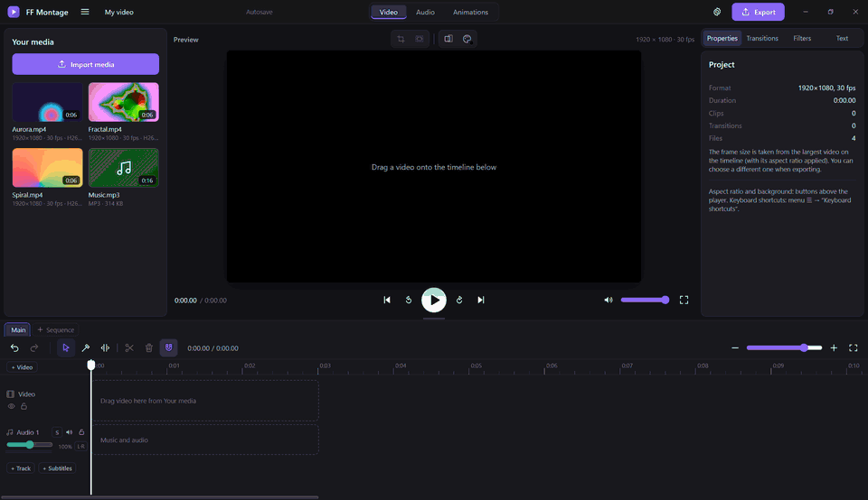

<p align="center">
  
</p>

<h1 align="center">FF Montage</h1>
<h3 align="center">Ein kostenloser Open-Source-Videoeditor mit FFmpeg unter der Haube.</h3>

<div align="center">



<p align="center">
  <a href="https://github.com/IsselSaizo/FFMontage/releases/latest"></a>
  <a href="https://github.com/IsselSaizo/FFMontage/releases"></a>
  <a href="https://github.com/IsselSaizo/FFMontage/actions/workflows/ci.yml"></a>
  <a href="#herunterladen"></a>
  <a href="../../LICENSE"></a>
</p>

<p align="center">
  <a href="https://github.com/IsselSaizo/FFMontage/releases/latest"></a>
</p>

[🇬🇧 English](../../README.md) · [🇷🇺 Русский](README.ru.md) · **🇩🇪 Deutsch** · [🇨🇳 简体中文](README.zh-Hans.md) · [🇯🇵 日本語](README.ja.md)

</div>

## Über FF Montage

FF Montage ist ein kostenloser Open-Source-Videoeditor für Windows, Linux und das Steam Deck. Die Vorschau spielt
dein Material so ab, wie es ist, und das fertige Video setzt **FFmpeg** zusammen: in der Auflösung und Bildrate der
Quelle (1440p60 bleibt 1440p60), in AV1, HEVC oder H.264 – auf der Grafikkarte (NVIDIA NVENC, Intel QSV, AMD AMF,
VA-API unter Linux), wenn eine vorhanden ist, sonst auf der CPU.

Kein Wasserzeichen, kein Konto, kein Abo, kein Upload. Alles läuft auf deinem Rechner: Das Programm ist eine einzige
Datei auf Basis von [Tauri 2](https://tauri.app) (Rust + die WebView des Systems), FFmpeg liegt direkt daneben.

**Geeignet für:** YouTube-Videos und Gameplay-Clips (NVIDIA-/OBS-Aufnahmen mit mehreren Audiospuren öffnen sich so,
wie sie sind), Shorts / Reels / TikTok in 9:16, Tutorials und Bildschirmaufnahmen, Interviews und Podcasts, Videos
mit Untertiteln, Sendemaster.

**Auch für Maschinen:** Ein eingebauter MCP-Server lässt Claude, Cursor und andere KI-Assistenten für dich schneiden,
und über eine Plugin-API in einer Sandbox kann jeder Effekte, Übergänge, Panels und Presets ergänzen.

Version 0.4.7. Neuigkeiten: [CHANGELOG.md](../../CHANGELOG.md) (auf Russisch).

## Highlights

- 🚫 **Kein Wasserzeichen. Kein Konto. Keine Paywall.** Freie Software unter der GPL-3.0.
- 🔒 **100 % lokal.** Nichts wird hochgeladen, alles funktioniert offline. Der KI-Assistent spricht nur mit dem Programm auf diesem Computer.
- ⚡ **FFmpeg-Export auf der GPU.** NVENC, QSV, AMF, VA-API oder die CPU. AV1, HEVC, H.264, bis zur Auflösung und Bildrate der Quelle.
- 🎞️ **Öffnet, was du aufnimmst.** H.264, HEVC und AV1 laufen ohne Konvertierung; MKV, TS, AVI und der Rest werden automatisch umverpackt (Remux) oder bekommen einen Proxy.
- ✂️ **Echte Schnittwerkzeuge.** Blade, Ripple- / Roll- / Slip- / Slide-Trims, In-/Out-Marken, Lift / Extract, JKL-Shuttle, magnetische Timeline.
- 🧱 **Mehrspurig.** Videospuren als Ebenen mit Transformation und Zuschnitt, beliebig viele Audiospuren, Untertitelspuren, mehrere Timelines (Episoden) in einem Projekt.
- 📝 **Titel und Untertitel.** Text, der in der Vorschau und im Export gleich aussieht; Import und Export von SRT / VTT / ASS.
- 🎚️ **Ordentlicher Ton.** EQ, Kompressor, Rauschunterdrückung, VST3- und CLAP-Plugins, Pegelanzeigen, Lautheitsnormalisierung in zwei Durchgängen, 5.1 / 7.1 / N Monokanäle.
- 📤 **Viele Formate.** MP4, MKV, MOV, GIF, MP3, M4A, WAV, OGG sowie ProRes- / DNxHR- / XDCAM-Master mit Timecode.
- 🧩 **Plugins.** Effekte, Übergänge, Textstile, Export- und Hotkey-Presets, Aktionen und Panels – alles in einer Sandbox.
- 🤖 **KI-Assistent (MCP).** Bitte Claude, die Pausen herauszuschneiden, Musik unter das Video zu legen und es in 1080p zu exportieren.
- ⌨️ **Deine Tastenkürzel.** Presets für Premiere Pro, DaVinci Resolve und CapCut plus eigene Kürzel; Gamepad und Touch auf dem Steam Deck.
- 🌍 **Oberfläche auf Englisch und Russisch**, umschaltbar ohne Neustart. Eine deutsche Oberfläche gibt es noch nicht – Menüs und Schaltflächen stehen in dieser Anleitung deshalb mit ihren englischen Namen.

## Funktionen

### Medien
- Import per Schaltfläche oder Drag-and-drop. **H.264, HEVC und AV1** öffnen sich ohne Konvertierung, wenn die
  WebView sie dekodieren kann; das Programm fragt dafür die WebView selbst, statt zu raten.
- **MKV, TS, M2TS, AVI** und andere Container: Spielt der Codec, wird der Stream ohne Neukodierung nach MP4
  umverpackt (Sekunden, Originalqualität); sonst entsteht ein 720p-Proxy. **Der Export verwendet immer die
  Originaldatei.**
- Aufnahmen mit **mehreren Audiostreams** (Spiel + Mikrofon aus NVIDIA ShadowPlay / OBS): Jeder Stream landet auf
  einem eigenen, verknüpften Audioclip.
- Bilder (JPG, PNG, WebP, BMP) und animierte GIFs.

### Timeline
- Verschieben, an den Rändern trimmen, teilen (`S`, `Alt+S` teilt alles unter dem Abspielkopf), Blade (`B`,
  `Shift`+Klick schneidet alle Spuren), Magnet, Überschreiben und Einfügen (`Alt`), Lücken erzeugen und schließen,
  Rückgängig / Wiederholen, Zoom.
- **Trim-Werkzeug (`T`)**: Der Rand eines Clips ist ein **Ripple**, die Naht zwischen zwei Clips ein **Roll**, die
  untere Hälfte ein **Slip**, die obere Hälfte ein **Slide**. Die Vorschau zeigt beide Frames rund um den Schnitt.
- **In-/Out-Marken** (`I` / `O`), **Lift** (`;`) und **Extract** (`'`), Trimmen bis zum Abspielkopf (`Q` / `W`).
- **JKL-Shuttle**: `L` spielt vorwärts ×1 → ×2 → ×4 → ×8, `J` rückwärts, `K` stoppt; `K` + `J` / `L` geht einen
  Frame zurück / vor.
- **Remove pauses…** (Pausen entfernen): Stille Stellen (FFmpeg `silencedetect`) werden samt Video herausgeschnitten,
  alles andere rückt nach.
- **Episoden**: mehrere Timelines in einem Projekt.
- Maus: Das Mausrad scrollt in der Zeit, `Shift` + Mausrad scrollt durch die Spuren, `Ctrl` + Mausrad zoomt.

### Video
- **Mehrere Videospuren**: Die Reihenfolge bestimmt die Ebenen; jede Spur lässt sich ausblenden oder sperren.
- **Transformation**: Position, Skalierung, Drehung, Deckkraft – mit einem Gizmo direkt im Player (rastet an der
  Mitte und an den Rändern ein) oder über Felder im Inspektor. **Zuschnitt** mit einem Rahmen im Player.
- **Geschwindigkeit** ×0,1–×16 (die Tonhöhe bleibt erhalten), Rückwärts, Standbild.
- **20 Übergänge** (0,1–3 s), **Filter** (Schwarzweiß, Sepia, Kontrast, Weichzeichner…), **Bildformate** 16:9, 9:16,
  1:1, 3:4 mit Hintergrund, Einpassen / Füllen / Strecken.
- Tab **Animations**: das Preset „Rain“ mit Live-Vorschau, gerendert in ein WebM mit Transparenz.
- Bild-in-Bild und Raster-Layouts – das Beispiel-Plugin `examples/plugins/layouts`.

### Text und Untertitel
- Titel, Bauchbinde, Bildunterschrift, Rolltitel (Abspann), einfacher Text. Schrift, Farbe, Kontur, Schatten,
  Hintergrundfläche, Ausrichtung.
- Inter und Open Sans sind eingebaut (mit Kyrillisch); eigene `.ttf`-/`.otf`-Schriften fügst du im Programm hinzu.
  **Der Text sieht im Player und im fertigen Video gleich aus.**
- **Untertitelspuren**: SRT / VTT / ASS importieren und speichern (Kodierung laut BOM, sonst UTF-8, sonst cp1251),
  Zeilen direkt auf der Timeline bearbeiten. Export: eingebrannt (libass) oder als separater Stream.

### Ton
- Videoton als separate, verknüpfte Clips, Musik- und Sprachspuren, Clip- und Spurlautstärke 0–200 %, Solo, Mute,
  Sperren, Blenden.
- Tab **Audio**: Equalizer, Kompressor und Rauschunterdrückung auf einem Clip oder einer ganzen Spur. **VST3- und
  CLAP-Plugins** (Windows x64) im selben Rack; das Plugin-Fenster öffnet sich separat, und ein abstürzendes Plugin
  reißt das Programm nicht mit.
- **Pegelanzeigen** auf jeder Spur und für den gesamten Mix (rot über −1 dBFS).
- **Lautheitsnormalisierung** in zwei Durchgängen: „Web −14 LUFS“, „Podcast −16 LUFS“, „Broadcast −23 LUFS (EBU R128)“.
- **Mehrkanalprojekte**: Stereo, Mono, 5.1, 7.1 oder bis zu 16 separate Monokanäle; Routing-Matrix
  „track → channels“ (Spur → Kanäle), „Split into channels“ (in Kanäle aufteilen) für Mehrkanalclips; der Player
  gibt einen Stereo-Downmix wieder.

### Export
- Video: **MP4, MKV, MOV, GIF**; nur Audio: **MP3, M4A, WAV, OGG**. Auflösung von 480p bis zur Quellauflösung,
  Fortschrittsanzeige und Abbrechen, der vollständige FFmpeg-Befehl in `<cache>/app/logs/last-export.log`.
- **AV1, HEVC, H.264** über NVIDIA NVENC, Intel QSV, AMD AMF, VA-API oder auf der CPU (SVT-AV1, x265, x264).
- MKV und MOV können **jede Audiospur als eigenen Stream** enthalten (zuerst der Mix, dann jede Spur mit ihrem Namen).
- **Master file** (Masterdatei): Apple ProRes 422 / HQ / 4444, Avid DNxHR SQ / HQ / HQX, Sony XDCAM HD422 (MXF),
  24-Bit-PCM, Start-**Timecode** (bei Bedarf Drop-Frame).
- Jeder FFmpeg-Befehl wird vor der Ausführung in Rust geprüft: Eingaben nur aus dem Projekt, Ausgabe nur in die
  Datei, die du gewählt hast.

### Plugins
- Ein Plugin ist ein Ordner mit `plugin.json`: **Effekte, Übergänge, Audioeffekte, Textstile, Export- und
  Hotkey-Presets, Lautheitsziele, Aktionen und Panels**. Die eingebauten Effekte sind selbst ein Plugin (`core`) auf
  derselben API.
- Plugins laufen in einer Sandbox (ein iframe ohne Zugriff auf das Programm, die Dateien oder FFmpeg). Effekte
  beschreiben FFmpeg-Filter deklarativ; nur Filter von der Whitelist kommen durch, und Rust prüft den gesamten Graphen
  noch einmal.
- Installation aus einem Ordner, einem Zip oder direkt von GitHub (`owner/repo`, SHA-256-geprüft); die Berechtigungen
  werden vor der Installation angezeigt. Anleitung: [docs/Guides/PLUGINS.md](../Guides/PLUGINS.md), Beispiele:
  [`examples/plugins`](../../examples/plugins).

### Alles Weitere
- **Tastenkürzel** mit den Presets „Default / DaVinci Resolve / Premiere Pro / CapCut“, eigene Kürzel obendrauf,
  Konfliktsuche, JSON-Export und -Import – die vollständige Tabelle steht in [docs/Guides/HOTKEYS.md](../Guides/HOTKEYS.md).
- **Steam Deck**: Gamepad-Steuerung (A — Wiedergabe, X — Teilen, B — Rückgängig, LB / RB — Frames, LT / RT —
  Shuttle…), touchfreundliche Griffe, ein Layout für 1280×800.
- Autosave, Projekte in einer einzigen `.ffproj`-Datei, portabler Modus, signierte Updates direkt aus dem Programm.
- **Absturzberichte** bleiben auf deiner Festplatte (`logs/reports`), nichts wird irgendwohin gesendet.

## Herunterladen

| | Windows | Linux |
|---|---|---|
| System | Windows 10 / 11 x64 | x86_64, glibc 2.35+ (Ubuntu 22.04+, Arch, SteamOS) |
| Fenster | WebView2 (in Windows 11 und einem aktuellen Windows 10) | WebKitGTK 4.1, GStreamer good (Ton und Bild in der Vorschau) |
| FFmpeg | im Release-Archiv enthalten | im Release-Archiv / im AppImage enthalten |
| Bildschirm | 1280×800 oder mehr | 1280×800 oder mehr |

macOS und ARM werden noch nicht unterstützt (geplant, siehe [ROADMAP](../Works/ROADMAP.md)).

### Fertiger Build

1. Öffne **[Releases](https://github.com/IsselSaizo/FFMontage/releases/latest)** und lade
   `FF-Montage-<version>-windows-x64.zip` (Windows) oder `FF-Montage-<version>-linux-x86_64.tar.gz` (Linux; auf dem
   Steam Deck und anderen Distributionen ist das AppImage weiter unten einfacher) herunter.
2. Entpacke es in einen beliebigen Ordner, in den du schreiben darfst (zum Beispiel `D:\FF Montage`).
3. Starte **`FF Montage.exe`** (Linux: `./ff-montage`). FFmpeg ist bereits im Archiv.

Windows meldet eventuell „Der Computer wurde durch Windows geschützt“: Klicke auf **Weitere Informationen** ›
**Trotzdem ausführen** (das Programm hat kein Code-Signing-Zertifikat).
Linux: `sudo apt install libwebkit2gtk-4.1-0 gstreamer1.0-plugins-good` (Ubuntu 22.04+),
Arch: `sudo pacman -S webkit2gtk-4.1 gst-plugins-good`.

**Wo die Daten liegen.** Der Windows-Zip-Build läuft in einem beschreibbaren Ordner im **portablen Modus**:
Einstellungen, deine Schriften, Plugins und der Cache liegen neben dem Programm, und der Ordner lässt sich als Ganzes
verschieben. Andernfalls (Linux, ein schreibgeschützter Ordner, Program Files) werden Systemordner verwendet:
Windows — `%APPDATA%\FF Montage` und `%LOCALAPPDATA%\FF Montage`,
Linux — `~/.config/ff-montage`, `~/.local/share/ff-montage`, `~/.cache/ff-montage`.
Den portablen Modus kannst du auch erzwingen: mit einer Datei `portable.txt` neben dem Programm oder mit
`FFM_PORTABLE=1` (`FFM_PORTABLE=0` schaltet ihn ab). Die aktuellen Pfade stehen unter **Settings → About**
(Einstellungen → Info).

**Updates:** Menü ☰ → **Check for updates…** (nach Updates suchen). Das Programm lädt das Archiv für dein System aus
dem neuesten Release herunter und installiert es nur, wenn die Signatur von `SHA256SUMS` gültig ist und der SHA-256
des Archivs übereinstimmt. Einstellungen und Projekte bleiben unberührt. Dateien von Hand prüfen:
`sha256sum -c SHA256SUMS --ignore-missing`.

### Linux und Steam Deck: AppImage

`FF-Montage-<version>-linux-x86_64.AppImage` ist eine einzige Datei, in der alles steckt: das Fenster (WebKitGTK),
GStreamer für Bild und Ton im Player und FFmpeg. Nichts zu installieren, kein `sudo`.

1. Lade das AppImage von [Releases](https://github.com/IsselSaizo/FFMontage/releases/latest) herunter, z. B. nach `~/Applications`.
2. Mach es ausführbar: `chmod +x FF-Montage-*.AppImage` (oder in Dolphin: Rechtsklick → Eigenschaften →
   Berechtigungen → Ausführbar).
3. Starte es per Doppelklick oder mit `./FF-Montage-<version>-linux-x86_64.AppImage`.

**Steam Deck.** Am bequemsten ist der **Desktop-Modus** (Ein-/Aus-Taste → Zum Desktop wechseln): Dort hast du
Tastatur und Maus / Touchpad, und die Dateien sind in Dolphin sichtbar. Start aus dem Spielmodus: Steam (auf dem
Desktop) → Spiele → Ein Nicht-Steam-Spiel zu meiner Bibliothek hinzufügen… → Durchsuchen… → das AppImage auswählen
(Filter „Alle Dateien“) → Ausgewählte Programme hinzufügen.
Das Fenster ist für 1280×800 ausgelegt; nutze im Spielmodus für Text und Tastenkürzel die Bildschirmtastatur
(Steam + X) oder eine angeschlossene Tastatur.

- Die Daten liegen in den XDG-Ordnern (`~/.config/ff-montage`, `~/.local/share/ff-montage`, `~/.cache/ff-montage`),
  denn das AppImage selbst ist schreibgeschützt. Cache-, Export- und Projektordner wählst du beim ersten Start (auf dem
  Deck eignet sich eine SD-Karte gut).
- **Aktualisieren** (Check for updates…) lädt das neue AppImage herunter, prüft Signatur und SHA-256 und ersetzt
  **dieselbe Datei** (der Name bleibt, die Steam-Verknüpfung funktioniert also weiter). Der Ordner des AppImage muss
  beschreibbar sein.
- Startet das AppImage wegen FUSE nicht (SteamOS hat es, manche Systeme nicht):
  `./FF-Montage-….AppImage --appimage-extract-and-run`, oder installiere `libfuse2`.
- Diagnose: `./FF-Montage-….AppImage --engine info </dev/null` zeigt, woher FFmpeg kommt, welche GStreamer-Plugins
  gefunden wurden und wohin die Daten geschrieben werden.
- Der Hardware-Export läuft auf dem Deck über VA-API (`h264_vaapi`, `hevc_vaapi`); die GPU des Deck kann kein AV1
  kodieren, daher übernimmt bei AV1 die CPU.

### Aus dem Quellcode

```powershell
git clone https://github.com/IsselSaizo/FFMontage.git
cd FFMontage
.\setup.cmd          # Linux: ./setup.sh
```

`setup` lädt FFmpeg nach `ffmpeg\` herunter (ein fest gepinnter Build, SHA-256-geprüft), installiert Rust (unter
Windows bei Bedarf auch die Visual Studio Build Tools über winget), baut das Programm zu **`FF Montage.exe`** und legt
eine Verknüpfung auf dem Desktop an. Der erste Build dauert 3–6 Minuten. In einem Git-Klon führt Check for updates…
`git pull` aus und baut neu.

- FFmpeg ist schon installiert: `.\setup.cmd -SkipFFmpeg`. Den Ordner kannst du beim ersten Start wählen.
- Ohne Grafikkarte läuft der Export auf der CPU (libsvtav1 / libx265 / libx264): langsamer, gleiches Ergebnis.

## Erster Start

Das Programm fragt nach seinen Ordnern:

| Ordner | Was dort landet |
|---|---|
| **Cache** | Vorschaubilder, Wellenformen, Proxys, Fensterdaten, Autosave, Logs |
| **Export** | fertige Videos |
| **Projects** (Projekte) | `.ffproj`-Dateien |
| **FFmpeg** | darf leer bleiben: Das Programm findet es selbst (ein Ordner `ffmpeg` neben dem Programm, benachbarte `ffmpeg-*`-Ordner, `PATH`) |

Die Ordner werden in `config.json` gespeichert, die Oberflächeneinstellungen in `settings.json` (beide im
Einstellungsordner, siehe „Wo die Daten liegen“). Ändern kannst du die Ordner unter **Settings → Folders**
(Einstellungen → Ordner); wenn du `config.json` löschst, erscheint das Fenster des ersten Starts wieder.

## Einstellungen

Menü ☰ → **Settings…** (`Ctrl+,`):

- **General** (Allgemein) — Sprache (Englisch / Russisch) und ob beim Start das letzte Projekt wieder geöffnet wird.
- **Keyboard shortcuts** (Tastenkürzel) — Preset, eigene Kürzel, Suche, Konflikte, JSON-Export und -Import.
- **Plugins** — Installation aus einem Ordner, einem Zip oder von GitHub; aktivieren, Berechtigungen, entfernen.
- **Audio plugins (VST3, CLAP)** (Audio-Plugins) — Ordner, Scan, Plugin hinzufügen.
- **Folders** (Ordner), **Cache** (Größen, Leeren nach Kategorie, Größenlimit), **AI assistant** (KI-Assistent),
  **About** (Info: Versionen, Pfade, Updates, Absturzberichte).

## KI-Assistent (MCP)

FF Montage verbindet sich über MCP (Model Context Protocol) mit KI-Assistenten. Claude Desktop, Cursor, VS Code oder
Claude Code können Dateien importieren, Clips schneiden und umstellen, Spuren, Text und Untertitel hinzufügen, die
Transformation ändern, Übergänge setzen, sich Frames „ansehen“, Pausen finden, Audiokanäle einrichten, das Projekt
speichern und das Video exportieren.

**Verbinden.** Unter Menü ☰ → **AI assistant (MCP)…** findest du fertiges JSON mit einer **Copy**-Schaltfläche.

- Claude Desktop: Settings → Developer → Edit Config, den Block in `claude_desktop_config.json` einfügen (wenn dort
  schon `"mcpServers"` steht, nur `"ff-montage"` ergänzen), Claude neu starten.
- Cursor: derselbe Block in `~/.cursor/mcp.json` (oder `.cursor/mcp.json` im Projektordner).
- VS Code: Der Block für `.vscode/mcp.json` (Schlüssel `"servers"`) steht im zweiten Feld des Fensters.
- Claude Code: Ein fertiger Befehl `claude mcp add …` steht im dritten Feld.

Der Server ist das Programm selbst mit dem Schalter `--mcp` (`"FF Montage.exe" --mcp`). Ist FF Montage geschlossen,
startet der Assistent es (die Ordner müssen beim ersten Start bereits gewählt worden sein).

**Was du fragen kannst:**

- „Importiere die Videos aus D:\Recordings\Holiday und bring sie in die richtige Reihenfolge, mit einer Überblendung
  zwischen den Clips.“
- „Finde im Interview Pausen, die länger als eine Sekunde sind, und schneide sie heraus.“
- „Leg C:\Music\track.mp3 mit 40 % Lautstärke unter das ganze Video, mit einer 3-Sekunden-Ausblendung am Ende.“
- „Füge für die ersten 4 Sekunden den Titel ‚Urlaub 2026‘ hinzu.“
- „Speichere das Projekt und exportiere es in 1080p H.264.“

**Sicherheit.** Der Assistent ändert das geöffnete Projekt: Jede Aktion erscheint auf der Timeline mit einem Hinweis
„AI: …“, und jede Änderung lässt sich mit `Ctrl+Z` rückgängig machen. Ein ungespeichertes Projekt schließt er nicht
ohne ausdrückliche Erlaubnis. Befehle werden nur von diesem Computer angenommen (Named Pipe / Unix-Socket, kein
Netzwerk) und nur mit dem geheimen Schlüssel aus `<cache>/app/mcp-endpoint.json`; der Schlüssel wird bei jedem Start
neu erzeugt und beim Beenden gelöscht.

## Tastenkürzel

Standard: Space — Wiedergabe / Pause, `S` — Teilen, `Alt+S` — alles unter dem Abspielkopf teilen, `B` / `A` — Blade /
Auswahl, `T` — Trimmen, `Delete` / `Shift+Delete` — Löschen / Ripple-Löschen, `Ctrl+Z` / `Ctrl+Y` — Rückgängig /
Wiederholen, `←` `→` — ein Frame (mit `Shift` — eine Sekunde), `J` `K` `L` — Shuttle, `I` / `O` — Marken.
Die vollständige Tabelle für jedes Preset: [docs/Guides/HOTKEYS.md](../Guides/HOTKEYS.md).

## So unterstützt du FF Montage

> [!IMPORTANT]
> **Die beste Unterstützung ist, FF Montage einfach zu benutzen – so, wie *du* es willst.** Schneide deine Videos
> damit und pass es an deinen Workflow an: Ändere die Tastenkürzel, wähle ein Preset, füge deine Schriften hinzu,
> binde deine VST3- / CLAP-Effekte ein, überlass die Routinearbeit einem KI-Assistenten.
>
> **Mach es mit Plugins zu deinem eigenen.** Dir fehlt ein Effekt, ein Übergang, ein Textstil, ein Export-Preset oder
> ein ganzes Panel? Schreib ein Plugin – [docs/Guides/PLUGINS.md](../Guides/PLUGINS.md) und [`examples/plugins`](../../examples/plugins)
> zeigen, wie es geht, und ein Plugin lässt sich direkt aus einem GitHub-Repository installieren. Teile es, und
> FF Montage wird für alle besser.
>
> Du hast eine Stelle gefunden, an der etwas kaputtgeht oder besser sein könnte?
> [Eröffne ein Issue](https://github.com/IsselSaizo/FFMontage/issues) – eine kurze Beschreibung und der Bericht aus
> `logs/reports` genügen. Ein ⭐ auf GitHub hilft anderen, das Projekt zu finden.

## Entwicklung

```text
src-tauri/      the Rust program: windows, paths and settings, FFmpeg (probe, thumbnails, waveform, proxy, reverse,
                freeze frame), export check and run, media:// and plugin:// protocols, plugins, fonts,
                audio plugin host (src/vst), MCP server (--mcp), updates, crash reports
src/renderer/   the interface: media, player, timeline, inspector, export, settings; js/exportPlan.js builds the
                FFmpeg command, js/keymap.js — actions and keys, js/plugins/ — the plugin host
mcp/tools.json  the AI assistant's tools
examples/       example plugins
tests/          engine, MCP, audio, subtitles, registry tests and UI self-tests
tools/          setup, FFmpeg download, release signing, hotkey table, version check
docs/           Guides (PLUGINS.md, HOTKEYS.md), Works (ROADMAP, audits), ReadMEs (translated READMEs)
.github/        CI on every push, release on a v* tag, AppImage build
```

**Build:** `cd src-tauri && cargo build --release` → `src-tauri/target/release/ff-montage(.exe)`.
Die Oberfläche wird beim Build in die exe eingebettet: Nach Änderungen an `src/renderer` neu bauen.
Du brauchst stabiles Rust, unter Linux zusätzlich `libwebkit2gtk-4.1-dev libgtk-3-dev librsvg2-dev`.

**Tests:**

| Befehl | Was er prüft |
|---|---|
| `cd src-tauri && cargo test` | Prüfung des Exportplans, Plugins, Pfade, Updates (SHA256SUMS, Signatur, Archivauswahl, Versionen) |
| `node tests/engine-test.js` | Export in jeden Codec, geprüft anhand der Pixelfarbe: Lücken, Übergänge, Blenden, Spuren, Text, Untertitel |
| `node tests/audio-test.js` | Lautheit, Kanallayouts, Routing, Broadcast-Master |
| `node tests/mcp-test.js` | den KI-Assistenten (braucht die Dateien aus engine-test; separater Cache) |
| `node tests/subtitles-test.js`, `registry-test.js`, `ffescape-test.js`, `layouts-test.js` | Untertitel, Registry, Escaping, das Beispiel-Plugin |
| `node tests/i18n-check.js` | ob jeder Oberflächen-String übersetzt ist |
| `node tools/syntax-check.mjs` | die Syntax aller Fenstermodule, ohne sie auszuführen |
| `powershell -ExecutionPolicy Bypass -File tests\run-ui.ps1 ui-selftest3` | einen Selbsttest der Oberfläche (Windows, separater Cache) |
| `bash tools/appimage-smoke.sh <file.AppImage>` | AppImage: FFmpeg und GStreamer enthalten, FFmpeg wird aus dem Image genommen, XDG-Pfade, `$APPIMAGE` |
| `bash tools/appimage-window.sh <file.AppImage or ff-montage>` | das Fenster unter xvfb: `<video>` über GStreamer |

Mit `FFM_NO_GPU=1` verhält sich das Programm wie ein Computer ohne Grafikkarte (so führt die CI die Tests aus).
Die CI prüft außerdem `cargo fmt --check`, `cargo clippy`, ob `docs/Guides/HOTKEYS.md` aktuell ist
(`node tools/hotkeys-doc.mjs`) und ob die Version in `Cargo.toml`, `tauri.conf.json` und `package.json` übereinstimmt
(`node tools/check-version.mjs`).

**Übersetzung:** Die Ausgangssprache ist Russisch; der String im Code ist der Schlüssel (`t('Новый проект')`), die
englischen Übersetzungen liegen in `src/renderer/js/i18n/en/*.js`, in Rust — `tr!("…", "…")`. Die übersetzten READMEs
liegen in [`docs/ReadMEs`](.).

**Release:** Erhöhe die Version in `src-tauri/Cargo.toml`, `src-tauri/tauri.conf.json`, `package.json` (und
`Cargo.lock`), ergänze `CHANGELOG.md`, dann `git tag v0.4.7 && git push origin v0.4.7`. Der Workflow prüft, ob der Tag
zur Version passt, baut die Archive, berechnet `SHA256SUMS` und signiert die Datei mit dem Schlüssel aus dem Secret
`FFM_SIGNING_KEY` (`tools/sign-release.mjs`). Ohne gültige Signatur installiert das Programm kein Update.

**AppImage** (`.github/workflows/appimage.yml`) wird bei jedem Push auf `main` und in jedem Release gebaut: tauri-cli
mit der Zusatzkonfiguration `.github/appimage.conf.json` (`bundleMediaFramework` — GStreamer im Paket, BtbN-FFmpeg per
SHA-256 gepinnt in `usr/bin/ffmpeg/bin`), danach ein Smoke-Test und das Fenster unter xvfb. Bricht der AppImage-Build
wegen externer Tools (linuxdeploy) ab, kann ein Release mit der Repository-Variable `FFM_APPIMAGE=0` auch ohne ihn
erscheinen. Unter Linux bekommen `<video>` / `<audio>` die Dateien per HTTP von 127.0.0.1 (zufälliger Port und Token,
`protocol.rs`): GStreamer in WebKitGTK öffnet keine eigenen Schemata wie `media://`.

## Lizenz

FF Montage ist freie Software unter der [GPL-3.0](../../LICENSE). FFmpeg — GPL (`gpl`-Builds von
[BtbN](https://github.com/BtbN/FFmpeg-Builds)), Tauri — MIT / Apache-2.0. Die Schriften Inter und Open Sans
(`fonts/`) — SIL OFL 1.1.
Audio-Plugins: die Bindings [vst3](https://github.com/coupler-rs/vst3-rs) (MIT / Apache-2.0, basierend auf dem
VST 3 SDK — MIT) und [clap-sys](https://github.com/micahrj/clap-sys) (MIT / Apache-2.0, CLAP — MIT). VST ist eine Marke
der Steinberg Media Technologies GmbH; das Programm verwendet das VST-Logo nicht. Plugins installiert der Nutzer selbst
und separat, unter ihren eigenen Lizenzen; das Programm vertreibt sie nicht.

FF Montage ist ein unabhängiges Projekt und weder mit dem FFmpeg-Projekt verbunden noch von ihm unterstützt. FFmpeg
ist eine Marke von Fabrice Bellard.

## DMCA

Code, Oberfläche und Dokumentation von FF Montage wurden für dieses Projekt geschrieben; Komponenten Dritter sind oben
mit ihren Lizenzen aufgeführt. Wenn du dennoch der Meinung bist, dass etwas in diesem Repository oder seinen Releases
dein Urheberrecht verletzt, eröffne ein [Issue](https://github.com/IsselSaizo/FFMontage/issues/new?title=Copyright%20notice)
mit dem Titel „Copyright notice“ – persönliche Angaben sind im Issue nicht nötig, wir antworten mit einem privaten
Kontakt – oder sende eine Meldung an GitHub gemäß der [DMCA Takedown Policy](https://docs.github.com/en/site-policy/content-removal-policies/dmca-takedown-policy).
Eine Meldung sollte das Werk nennen, dessen Inhaber du bist, auf das betreffende Material hier verlinken, deine
Kontaktdaten angeben und die Erklärung enthalten, dass du in gutem Glauben davon ausgehst, dass die Nutzung nicht
genehmigt ist, dass die Meldung zutreffend ist und dass du der Inhaber bist oder befugt bist, für ihn zu handeln.
Gültige Meldungen werden umgehend bearbeitet; der Urheber entfernten Materials kann auf demselben Weg eine
Gegendarstellung (Counter-Notice) einreichen.
