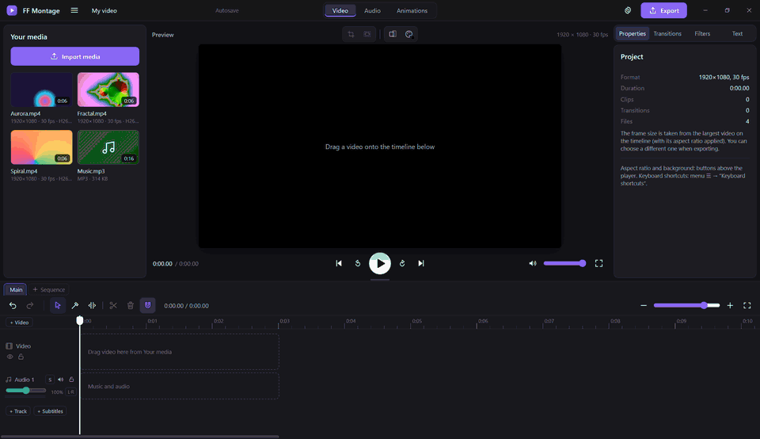

<p align="center">
  
</p>

<h1 align="center">FF Montage</h1>
<h3 align="center">FFmpeg を中核に据えた、無料・オープンソースの動画編集ソフト。</h3>

<div align="center">



<p align="center">
  <a href="https://github.com/IsselSaizo/FFMontage/releases/latest"></a>
  <a href="https://github.com/IsselSaizo/FFMontage/releases"></a>
  <a href="https://github.com/IsselSaizo/FFMontage/actions/workflows/ci.yml"></a>
  <a href="#ダウンロード"></a>
  <a href="../../LICENSE"></a>
</p>

<p align="center">
  <a href="https://github.com/IsselSaizo/FFMontage/releases/latest"></a>
</p>

[🇬🇧 English](../../README.md) · [🇷🇺 Русский](README.ru.md) · [🇩🇪 Deutsch](README.de.md) · [🇨🇳 简体中文](README.zh-Hans.md) · **🇯🇵 日本語**

</div>

## 概要

FF Montage は、Windows・Linux・Steam Deck 向けの無料・オープンソースの動画編集ソフトです。プレビューでは素材をそのまま
再生し、完成した動画は **FFmpeg** が書き出します。解像度とフレームレートは素材のまま（1440p60 は 1440p60 のまま）、
コーデックは AV1・HEVC・H.264 から選べ、グラフィックスカードがあれば GPU（NVIDIA NVENC、Intel QSV、AMD AMF、Linux では
VA-API）で、なければ CPU でエンコードします。

透かしなし、アカウント不要、サブスクリプションなし、アップロードもありません。すべてお使いのコンピューター上で動作します。
本体は [Tauri 2](https://tauri.app)（Rust ＋ システムの WebView）で作られた単一ファイルで、その隣に FFmpeg が置かれます。

**こんな用途に：** YouTube 動画やゲームクリップ（複数の音声トラックを持つ NVIDIA / OBS の録画もそのまま開けます）、
9:16 の Shorts / Reels / TikTok、チュートリアルや画面録画、インタビューやポッドキャスト、字幕付き動画、放送用マスター。

**AI からも使えます：** 内蔵の MCP サーバーにより、Claude や Cursor などの AI アシスタントが代わりに編集できます。
また、サンドボックス化されたプラグイン API で、誰でもエフェクト、トランジション、パネル、プリセットを追加できます。

バージョン 0.4.7。更新内容：[CHANGELOG.md](../../CHANGELOG.md)（ロシア語）。

## 主な特長

- 🚫 **透かしなし。アカウント不要。課金なし。** GPL-3.0 のフリーソフトウェアです。
- 🔒 **100% ローカル。** 何もアップロードされず、オフラインで動作します。AI アシスタントもこのコンピューター上のプログラムとだけ通信します。
- ⚡ **GPU による FFmpeg 書き出し。** NVENC、QSV、AMF、VA-API、または CPU。AV1、HEVC、H.264 で、素材の解像度とフレームレートまで対応します。
- 🎞️ **録画したファイルをそのまま開けます。** H.264、HEVC、AV1 は変換なしで再生でき、MKV、TS、AVI などは自動でリマックスまたはプロキシ化されます。
- ✂️ **本格的な編集ツール。** ブレード、リップル / ロール / スリップ / スライドのトリミング、In / Out マーク、リフト / 抽出、JKL シャトル、マグネットタイムライン。
- 🧱 **マルチトラック。** トランスフォームとクロップ付きのレイヤーとしてのビデオトラック、無制限のオーディオトラック、字幕トラック、1 つのプロジェクトに複数のタイムライン（エピソード）。
- 📝 **タイトルと字幕。** プレビューと書き出し結果で見た目が同じテキスト。SRT / VTT / ASS の読み込みと書き出し。
- 🎚️ **しっかりしたサウンド。** EQ、コンプレッサー、ノイズ除去、VST3 / CLAP プラグイン、レベルメーター、2 パスのラウドネス正規化、5.1 / 7.1 / N 個のモノラルチャンネル。
- 📤 **多彩なフォーマット。** MP4、MKV、MOV、GIF、MP3、M4A、WAV、OGG、さらにタイムコード付きの ProRes / DNxHR / XDCAM マスター。
- 🧩 **プラグイン。** エフェクト、トランジション、テキストスタイル、書き出し・ショートカットのプリセット、アクション、パネル。すべてサンドボックス内で動作します。
- 🤖 **AI アシスタント（MCP）。** 「間を詰めて、動画の下に音楽を敷いて、1080p で書き出して」と Claude に頼めます。
- ⌨️ **自分好みのショートカット。** Premiere Pro、DaVinci Resolve、CapCut のプリセットに加えて独自のショートカットも設定可能。Steam Deck ではゲームパッドとタッチ操作に対応します。
- 🌍 **英語とロシア語のインターフェース**。再起動なしで切り替えられます（日本語 UI はまだありません）。

## 機能

### メディア
- ボタンまたはドラッグ＆ドロップで読み込み。**H.264、HEVC、AV1** は WebView がデコードできる場合は変換なしで開きます。
  推測ではなく、WebView 自体に対応状況を問い合わせます。
- **MKV、TS、M2TS、AVI** などのコンテナ：コーデックが再生可能なら、再エンコードせずに MP4 へリマックスします
  （数秒で完了、画質は元のまま）。再生できない場合は 720p のプロキシを作成します。**書き出しには常に元のファイルを使います。**
- **複数の音声ストリーム**を持つ録画（NVIDIA ShadowPlay / OBS のゲーム音＋マイク）：各ストリームがそれぞれリンクされた
  オーディオクリップになります。
- 画像（JPG、PNG、WebP、BMP）とアニメーション GIF。

### タイムライン
- 移動、端でのトリミング、分割（`S`、`Alt+S` で再生ヘッド下のすべてを分割）、ブレード（`B`、`Shift`＋クリックで全トラックを
  カット）、マグネット、上書きと挿入（`Alt`）、ギャップとギャップの削除、元に戻す / やり直し、ズーム。
- **トリムツール（`T`）**：クリップの端は**リップル**、2 つのクリップの境目は**ロール**、下半分は**スリップ**、上半分は
  **スライド**です。プレビューには編集点の前後 2 フレームが表示されます。
- **In / Out マーク**（`I` / `O`）、**リフト**（`;`）と**抽出**（`'`）、再生ヘッドまでトリム（`Q` / `W`）。
- **JKL シャトル**：`L` で順方向に ×1 → ×2 → ×4 → ×8、`J` で逆方向、`K` で停止。`K` ＋ `J` / `L` で 1 フレームずつ移動します。
- **Remove pauses…**（無音部分を削除）：無音区間（FFmpeg `silencedetect`）を映像ごとカットし、残りを詰めます。
- **エピソード**：1 つのプロジェクトに複数のタイムライン。
- マウス：ホイールで時間方向にスクロール、`Shift` ＋ホイールでトラックをスクロール、`Ctrl` ＋ホイールでズーム。

### 映像
- **複数のビデオトラック**：順序がレイヤーの重なりになります。各トラックは非表示やロックが可能です。
- **トランスフォーム**：位置、スケール、回転、不透明度。プレーヤー上のギズモ（中央と端にスナップ）でも、インスペクターの
  入力欄でも調整できます。プレーヤー上の枠で**クロップ**も可能です。
- **速度** ×0.1〜×16（ピッチは維持）、逆再生、フリーズフレーム。
- **20 種類のトランジション**（0.1〜3 秒）、**フィルター**（白黒、セピア、コントラスト、ぼかし…）、背景付きの
  **フレーム形式** 16:9、9:16、1:1、3:4、フィット / フィル / ストレッチ。
- **Animations** タブ：ライブプレビュー付きの「Rain」プリセット。透過付き WebM として焼き込まれます。
- ピクチャー・イン・ピクチャーやグリッドレイアウトは、サンプルプラグイン `examples/plugins/layouts` で利用できます。

### テキストと字幕
- タイトル、ロワーサード、キャプション、エンドロール、プレーンテキスト。フォント、色、縁取り、影、背景プレート、配置。
- Inter と Open Sans を内蔵（キリル文字対応）。独自の `.ttf` / `.otf` フォントもプログラム内で追加できます。
  **テキストはプレーヤーでも完成動画でも同じ見た目になります。**
- **字幕トラック**：SRT / VTT / ASS の読み込みと保存（エンコーディングは BOM から判定し、なければ UTF-8、それも違えば cp1251）、
  タイムライン上での行の編集。書き出し：焼き込み（libass）または別ストリーム。

### サウンド
- 映像の音声はリンクされた別クリップとして扱われます。音楽・ナレーション用トラック、クリップとトラックの音量 0〜200 %、
  ソロ、ミュート、ロック、フェード。
- **Audio** タブ：クリップまたはトラック全体にイコライザー、コンプレッサー、ノイズ除去。**VST3 / CLAP プラグイン**
  （Windows x64）も同じラックで使えます。プラグインのウィンドウは別に開き、プラグインがクラッシュしてもプログラムは落ちません。
- 各トラックとミックス全体に**レベルメーター**（−1 dBFS 超で赤表示）。
- 2 パスの**ラウドネス正規化**：“Web −14 LUFS”、“Podcast −16 LUFS”、“Broadcast −23 LUFS (EBU R128)”。
- **マルチチャンネルプロジェクト**：ステレオ、モノラル、5.1、7.1、または最大 16 の独立したモノラルチャンネル。
  「トラック → チャンネル」のルーティングマトリクス、マルチチャンネルクリップ用の “Split into channels”（チャンネルに分割）。
  プレーヤーではステレオにダウンミックスして再生します。

### 書き出し
- 映像：**MP4、MKV、MOV、GIF**、音声のみ：**MP3、M4A、WAV、OGG**。解像度は 480p から素材の解像度まで。進捗表示とキャンセルに対応し、
  実行した FFmpeg コマンドの全文は `<cache>/app/logs/last-export.log` に記録されます。
- **AV1、HEVC、H.264** を NVIDIA NVENC、Intel QSV、AMD AMF、VA-API、または CPU（SVT-AV1、x265、x264）でエンコード。
- MKV と MOV では**各オーディオトラックを個別のストリーム**として格納できます（最初にミックス、続いて各トラックを名前付きで）。
- **Master file**（マスターファイル）：Apple ProRes 422 / HQ / 4444、Avid DNxHR SQ / HQ / HQX、Sony XDCAM HD422 (MXF)、
  24-bit PCM、開始**タイムコード**（必要に応じてドロップフレーム）。
- すべての FFmpeg コマンドは実行前に Rust 側で検査されます。入力はプロジェクト内のファイルのみ、出力は選択したファイルのみです。

### プラグイン
- プラグインは `plugin.json` を含むフォルダーです：**エフェクト、トランジション、オーディオエフェクト、テキストスタイル、
  書き出し・ショートカットのプリセット、ラウドネス目標値、アクション、パネル**。内蔵エフェクトも同じ API 上のプラグイン（`core`）です。
- プラグインはサンドボックス（プログラム、ファイル、FFmpeg にアクセスできない iframe）内で動作します。エフェクトは FFmpeg
  フィルターを宣言的に記述し、許可リストにあるフィルターだけが通過し、さらに Rust がグラフ全体を再検査します。
- フォルダー、zip、または GitHub（`owner/repo`、SHA-256 を検証）から直接インストールできます。インストール前に権限が
  表示されます。ガイド：[docs/Guides/PLUGINS.md](../Guides/PLUGINS.md)、サンプル：[`examples/plugins`](../../examples/plugins)。

### その他
- **ショートカット**：“Default / DaVinci Resolve / Premiere Pro / CapCut” のプリセットに独自のショートカットを上書き可能。
  競合の検索、JSON での書き出しと読み込み。全一覧は [docs/Guides/HOTKEYS.md](../Guides/HOTKEYS.md) にあります。
- **Steam Deck**：ゲームパッド操作（A — 再生、X — 分割、B — 元に戻す、LB / RB — フレーム移動、LT / RT — シャトル…）、
  タッチしやすいハンドル、1280×800 向けのレイアウト。
- 自動保存、単一の `.ffproj` ファイルによるプロジェクト、ポータブルモード、プログラム内からの署名付きアップデート。
- **クラッシュレポート**はディスク上（`logs/reports`）に保存されるだけで、どこにも送信されません。

## ダウンロード

| | Windows | Linux |
|---|---|---|
| システム | Windows 10 / 11 x64 | x86_64、glibc 2.35 以上（Ubuntu 22.04 以降、Arch、SteamOS） |
| ウィンドウ | WebView2（Windows 11 および更新済みの 10 に搭載） | WebKitGTK 4.1、GStreamer good（プレビューの音声と映像用） |
| FFmpeg | リリースアーカイブに同梱 | リリースアーカイブ / AppImage に同梱 |
| 画面 | 1280×800 以上 | 1280×800 以上 |

macOS と ARM にはまだ対応していません（予定あり。[ROADMAP](../Works/ROADMAP.md) を参照）。

### ビルド済みパッケージ

1. **[Releases](https://github.com/IsselSaizo/FFMontage/releases/latest)** を開き、
   `FF-Montage-<version>-windows-x64.zip`（Windows）または `FF-Montage-<version>-linux-x86_64.tar.gz`（Linux。
   Steam Deck やその他のディストリビューションでは、後述の AppImage のほうが簡単です）をダウンロードします。
2. 書き込み可能な任意のフォルダー（例：`D:\FF Montage`）に展開します。
3. **`FF Montage.exe`**（Linux：`./ff-montage`）を実行します。FFmpeg はアーカイブに同梱済みです。

Windows で「WindowsによってPCが保護されました」と表示された場合は、**詳細情報** › **実行** をクリックしてください
（このプログラムにはコード署名証明書がありません）。
Linux：`sudo apt install libwebkit2gtk-4.1-0 gstreamer1.0-plugins-good`（Ubuntu 22.04 以降）、
Arch：`sudo pacman -S webkit2gtk-4.1 gst-plugins-good`。

**データの保存場所。** Windows の zip 版を書き込み可能なフォルダーで実行すると**ポータブルモード**になります。設定、
追加したフォント、プラグイン、キャッシュはプログラムの隣に置かれ、フォルダーごと移動できます。それ以外の場合（Linux、
読み取り専用フォルダー、Program Files）はシステムのフォルダーを使います：Windows — `%APPDATA%\FF Montage` と
`%LOCALAPPDATA%\FF Montage`、Linux — `~/.config/ff-montage`、`~/.local/share/ff-montage`、`~/.cache/ff-montage`。
ポータブルモードは強制することもできます：プログラムの隣に `portable.txt` を置くか、`FFM_PORTABLE=1` を設定します
（`FFM_PORTABLE=0` で無効化）。現在のパスは **Settings → About** で確認できます。

**アップデート：** メニュー ☰ → **Check for updates…**（アップデートを確認）。プログラムは最新リリースからお使いの
システム用のアーカイブをダウンロードし、`SHA256SUMS` の署名が有効で、かつアーカイブの SHA-256 が一致した場合にのみ
インストールします。設定とプロジェクトには手を加えません。手動でファイルを検証するには：
`sha256sum -c SHA256SUMS --ignore-missing`。

### Linux と Steam Deck：AppImage

`FF-Montage-<version>-linux-x86_64.AppImage` は、ウィンドウ（WebKitGTK）、プレーヤーの映像・音声用の GStreamer、
FFmpeg をすべて含んだ単一ファイルです。インストール不要で、`sudo` も要りません。

1. [Releases](https://github.com/IsselSaizo/FFMontage/releases/latest) から AppImage を、たとえば `~/Applications` にダウンロードします。
2. 実行権限を付けます：`chmod +x FF-Montage-*.AppImage`（または Dolphin で右クリック → プロパティ → パーミッション →
   実行可能）。
3. ダブルクリックするか、`./FF-Montage-<version>-linux-x86_64.AppImage` で起動します。

**Steam Deck。** いちばん快適なのは**デスクトップモード**です（電源ボタン → デスクトップに切り替え）。キーボードと
マウス / タッチパッドが使え、ファイルも Dolphin で確認できます。ゲームモードから起動するには：（デスクトップ上の）Steam →
ゲーム → 非Steamゲームをマイライブラリに追加… → 参照… → AppImage を選択（フィルターは「すべてのファイル」）→
選択したプログラムを追加。
ウィンドウは 1280×800 向けに設計されています。ゲームモードでは、テキスト入力やショートカットに画面キーボード
（Steam ＋ X）または接続したキーボードを使ってください。

- データは XDG フォルダー（`~/.config/ff-montage`、`~/.local/share/ff-montage`、`~/.cache/ff-montage`）に保存されます。
  AppImage 自体は読み取り専用です。キャッシュ、書き出し、プロジェクトのフォルダーは初回起動時に選択します（Deck では SD カードがおすすめです）。
- **アップデート**（Check for updates…）は新しい AppImage をダウンロードし、署名と SHA-256 を検証してから**同じファイル**を
  置き換えます（ファイル名が変わらないので、Steam のショートカットもそのまま使えます）。AppImage のあるフォルダーは書き込み可能である必要があります。
- FUSE が原因で AppImage が起動しない場合（SteamOS には入っていますが、入っていないシステムもあります）：
  `./FF-Montage-….AppImage --appimage-extract-and-run` を使うか、`libfuse2` をインストールしてください。
- 診断：`./FF-Montage-….AppImage --engine info </dev/null` で、FFmpeg の取得元、見つかった GStreamer プラグイン、
  データの書き込み先が表示されます。
- Deck でのハードウェア書き出しは VA-API（`h264_vaapi`、`hevc_vaapi`）です。Deck の GPU は AV1 をエンコードできないため、AV1 は CPU で処理されます。

### ソースから

```powershell
git clone https://github.com/IsselSaizo/FFMontage.git
cd FFMontage
.\setup.cmd          # Linux: ./setup.sh
```

`setup` は FFmpeg を `ffmpeg\` にダウンロード（バージョン固定のビルド、SHA-256 を検証）し、Rust をインストール
（Windows では必要に応じて winget で Visual Studio Build Tools も）、プログラムを **`FF Montage.exe`** としてビルドし、
デスクトップにショートカットを作成します。初回のビルドには 3〜6 分かかります。git クローンでは、Check for updates… を
実行すると `git pull` と再ビルドが行われます。

- FFmpeg がインストール済みの場合：`.\setup.cmd -SkipFFmpeg`。そのフォルダーは初回起動時に選択できます。
- グラフィックスカードがない場合、書き出しは CPU（libsvtav1 / libx265 / libx264）で行われます。遅くなりますが、結果は同じです。

## 初回起動

プログラムが使用するフォルダーを尋ねます：

| フォルダー | 保存されるもの |
|---|---|
| **Cache**（キャッシュ） | サムネイル、波形、プロキシ、ウィンドウのデータ、自動保存、ログ |
| **Export**（書き出し） | 完成した動画 |
| **Projects**（プロジェクト） | `.ffproj` ファイル |
| **FFmpeg** | 空のままで構いません。プログラムが自動で探します（プログラムの隣の `ffmpeg` フォルダー、隣接する `ffmpeg-*` フォルダー、`PATH`） |

フォルダーは `config.json` に、インターフェースの設定は `settings.json` に保存されます（どちらも設定フォルダー内。
「データの保存場所」を参照）。フォルダーは **Settings → Folders** で変更できます。`config.json` を削除すると、
初回起動時のウィンドウが再び表示されます。

## 設定

メニュー ☰ → **Settings…**（`Ctrl+,`）：

- **General**（一般）— 言語（English / Russian）、起動時に前回のプロジェクトを開くかどうか。
- **Keyboard shortcuts**（キーボードショートカット）— プリセット、独自のショートカット、検索、競合、JSON の書き出しと読み込み。
- **Plugins**（プラグイン）— フォルダー、zip、GitHub からのインストール、有効化、権限、削除。
- **Audio plugins (VST3, CLAP)**（オーディオプラグイン）— フォルダー、スキャン、プラグインの追加。
- **Folders**（フォルダー）、**Cache**（キャッシュ：サイズ、カテゴリー別の削除、サイズ上限）、**AI assistant**（AI アシスタント）、
  **About**（情報：バージョン、パス、アップデート、クラッシュレポート）。

## AI アシスタント（MCP）

FF Montage は MCP（Model Context Protocol）を通じて AI アシスタントと連携します。Claude Desktop、Cursor、VS Code、
Claude Code から、ファイルの読み込み、クリップのカットや並べ替え、トラック・テキスト・字幕の追加、トランスフォームの変更、
トランジションの設定、フレームの「確認」、間の検出、オーディオチャンネルの設定、プロジェクトの保存、動画の書き出しができます。

**接続方法。** メニュー ☰ → **AI assistant (MCP)…** に、コピーボタン付きの JSON が用意されています。

- Claude Desktop：Settings → Developer → Edit Config を開き、ブロックを `claude_desktop_config.json` に貼り付けます
  （すでに `"mcpServers"` がある場合は `"ff-montage"` だけを追加）。その後 Claude を再起動します。
- Cursor：同じブロックを `~/.cursor/mcp.json`（またはプロジェクトフォルダーの `.cursor/mcp.json`）に追加します。
- VS Code：`.vscode/mcp.json` 用のブロック（キーは `"servers"`）がウィンドウの 2 番目の欄にあります。
- Claude Code：そのまま使える `claude mcp add …` コマンドが 3 番目の欄にあります。

サーバーは `--mcp` スイッチを付けたプログラム自身です（`"FF Montage.exe" --mcp`）。FF Montage が起動していなければ、
アシスタントが起動します（初回起動時のフォルダー選択が済んでいる必要があります）。

**依頼の例：**

- 「D:\Recordings\Holiday の動画を読み込んで順番に並べて、クリップの間にディゾルブを入れて」
- 「インタビューの中から 1 秒以上の間を見つけてカットして」
- 「C:\Music\track.mp3 を動画全体の下に音量 40 % で敷いて、最後に 3 秒のフェードを付けて」
- 「最初の 4 秒間に『Holiday 2026』というタイトルを入れて」
- 「プロジェクトを保存して、1080p の H.264 で書き出して」

**安全性。** アシスタントは開いているプロジェクトを変更します。すべての操作は “AI: …” という通知とともにタイムラインに
表示され、どの編集も `Ctrl+Z` で元に戻せます。明示的な許可なしに未保存のプロジェクトを閉じることはありません。コマンドは
このコンピューターからのみ（名前付きパイプ / Unix ソケット経由、ネットワークは使用しません）、かつ
`<cache>/app/mcp-endpoint.json` の秘密鍵がある場合にのみ受け付けます。鍵は起動のたびに新しく作成され、終了時に削除されます。

## ショートカット

デフォルト：Space — 再生 / 一時停止、`S` — 分割、`Alt+S` — 再生ヘッド下のすべてを分割、`B` / `A` — ブレード / 選択、
`T` — トリム、`Delete` / `Shift+Delete` — 削除 / リップル削除、`Ctrl+Z` / `Ctrl+Y` — 元に戻す / やり直し、
`←` `→` — 1 フレーム（`Shift` 併用で 1 秒）、`J` `K` `L` — シャトル、`I` / `O` — マーク。
全プリセットの一覧：[docs/Guides/HOTKEYS.md](../Guides/HOTKEYS.md)。

## FF Montage を応援するには

> [!IMPORTANT]
> **いちばんの応援は、FF Montage を*あなたの*やり方で使っていただくことです。** 動画の編集に使い、自分のワークフローに
> 合わせてください。ショートカットを変え、プリセットを選び、フォントを追加し、VST3 / CLAP エフェクトをつなぎ、
> 定型作業は AI アシスタントに任せましょう。
>
> **プラグインで自分仕様に。** エフェクト、トランジション、テキストスタイル、書き出しプリセット、あるいはパネルが丸ごと
> 足りない？ それならプラグインを書いてみてください。方法は [docs/Guides/PLUGINS.md](../Guides/PLUGINS.md) と
> [`examples/plugins`](../../examples/plugins) にあり、プラグインは GitHub リポジトリから直接インストールできます。
> 公開すれば、FF Montage がみんなにとってより良いものになります。
>
> 不具合や改善点を見つけたら、[Issue を作成](https://github.com/IsselSaizo/FFMontage/issues)してください。
> 短い説明と `logs/reports` のレポートがあれば十分です。GitHub での ⭐ は、ほかの人がこのプロジェクトを見つける助けになります。

## 開発

```text
src-tauri/      Rust 製のプログラム本体：ウィンドウ、パスと設定、FFmpeg（解析、サムネイル、波形、プロキシ、逆再生、
                フリーズフレーム）、書き出しの検査と実行、media:// と plugin:// プロトコル、プラグイン、フォント、
                オーディオプラグインホスト（src/vst）、MCP サーバー（--mcp）、アップデート、クラッシュレポート
src/renderer/   インターフェース：メディア、プレーヤー、タイムライン、インスペクター、書き出し、設定。js/exportPlan.js が
                FFmpeg コマンドを組み立て、js/keymap.js — アクションとキー、js/plugins/ — プラグインホスト
mcp/tools.json  AI アシスタントのツール
examples/       サンプルプラグイン
tests/          エンジン、MCP、オーディオ、字幕、レジストリのテストと UI セルフテスト
tools/          セットアップ、FFmpeg のダウンロード、リリース署名、ショートカット一覧、バージョンチェック
docs/           Guides（PLUGINS.md、HOTKEYS.md）、Works（ROADMAP、監査）、ReadMEs（翻訳版 README）
.github/        push ごとの CI、v* タグでのリリース、AppImage のビルド
```

**ビルド：** `cd src-tauri && cargo build --release` → `src-tauri/target/release/ff-montage(.exe)`。
インターフェースはビルド時に exe に埋め込まれるため、`src/renderer` を変更したら再ビルドしてください。
安定版の Rust が必要です。Linux ではさらに `libwebkit2gtk-4.1-dev libgtk-3-dev librsvg2-dev` が必要です。

**テスト：**

| コマンド | 検査内容 |
|---|---|
| `cd src-tauri && cargo test` | 書き出しプランの検査、プラグイン、パス、アップデート（SHA256SUMS、署名、アーカイブの選択、バージョン） |
| `node tests/engine-test.js` | 全コーデックへの書き出しをピクセルの色で検証：ギャップ、トランジション、フェード、トラック、テキスト、字幕 |
| `node tests/audio-test.js` | ラウドネス、チャンネルレイアウト、ルーティング、放送用マスター |
| `node tests/mcp-test.js` | AI アシスタント（engine-test のファイルが必要。キャッシュは別） |
| `node tests/subtitles-test.js`, `registry-test.js`, `ffescape-test.js`, `layouts-test.js` | 字幕、レジストリ、エスケープ、サンプルプラグイン |
| `node tests/i18n-check.js` | インターフェースのすべての文字列が翻訳されているか |
| `node tools/syntax-check.mjs` | すべてのウィンドウモジュールの構文（実行はしない） |
| `powershell -ExecutionPolicy Bypass -File tests\run-ui.ps1 ui-selftest3` | インターフェースのセルフテスト（Windows、キャッシュは別） |
| `bash tools/appimage-smoke.sh <file.AppImage>` | AppImage：FFmpeg と GStreamer の同梱、イメージ内の FFmpeg の使用、XDG パス、`$APPIMAGE` |
| `bash tools/appimage-window.sh <file.AppImage or ff-montage>` | xvfb 上のウィンドウ：GStreamer 経由の `<video>` |

`FFM_NO_GPU=1` を設定すると、プログラムはグラフィックスカードのないコンピューターと同じように動作します（CI はこの設定でテストを実行します）。
CI ではさらに `cargo fmt --check`、`cargo clippy`、`docs/HOTKEYS.md` が最新であること（`node tools/hotkeys-doc.mjs`）、
`Cargo.toml`、`tauri.conf.json`、`package.json` のバージョンが一致していること（`node tools/check-version.mjs`）を確認します。

**翻訳：** 原文の言語はロシア語で、コード内の文字列がそのままキーになります（`t('Новый проект')`）。英語訳は
`src/renderer/js/i18n/en/*.js` にあり、Rust では `tr!("…", "…")` を使います。翻訳版の README は
[`docs/ReadMEs`](.) にあります。

**リリース手順：** `src-tauri/Cargo.toml`、`src-tauri/tauri.conf.json`、`package.json`（および `Cargo.lock`）のバージョンを
上げ、`CHANGELOG.md` に追記してから `git tag v0.4.7 && git push origin v0.4.7` を実行します。ワークフローはタグとバージョンの
一致を確認し、アーカイブをビルドして `SHA256SUMS` を計算し、`FFM_SIGNING_KEY` シークレットの鍵で署名します
（`tools/sign-release.mjs`）。有効な署名がなければ、プログラムはアップデートをインストールしません。

**AppImage**（`.github/workflows/appimage.yml`）は `main` への push ごとと各リリースでビルドされます。追加設定
`.github/appimage.conf.json` を指定した tauri-cli（`bundleMediaFramework` — GStreamer を同梱、SHA-256 で固定した BtbN の
FFmpeg を `usr/bin/ffmpeg/bin` に配置）でビルドし、続いてスモークテストと xvfb 上でのウィンドウテストを行います。外部ツール
（linuxdeploy）が原因で AppImage のビルドが失敗する場合は、リポジトリ変数 `FFM_APPIMAGE=0` を設定すれば AppImage なしで
リリースできます。Linux では、`<video>` / `<audio>` は 127.0.0.1 から HTTP 経由でファイルを取得します（ランダムなポートと
トークン、`protocol.rs`）。WebKitGTK の GStreamer は `media://` のようなカスタムスキームを開けないためです。

## ライセンス

FF Montage は [GPL-3.0](../../LICENSE) のフリーソフトウェアです。FFmpeg — GPL（[BtbN](https://github.com/BtbN/FFmpeg-Builds)
の `gpl` ビルド）、Tauri — MIT / Apache-2.0。フォント Inter と Open Sans（`fonts/`）— SIL OFL 1.1。
オーディオプラグイン：[vst3](https://github.com/coupler-rs/vst3-rs) バインディング（MIT / Apache-2.0、VST 3 SDK ベース — MIT）
と [clap-sys](https://github.com/micahrj/clap-sys)（MIT / Apache-2.0、CLAP — MIT）。VST は Steinberg Media Technologies GmbH
の商標です。本プログラムは VST ロゴを使用していません。プラグインはユーザーが各自のライセンスのもとで別途インストールする
ものであり、本プログラムはそれらを配布しません。

FF Montage は独立したプロジェクトであり、FFmpeg プロジェクトとは提携しておらず、その承認も受けていません。FFmpeg は
Fabrice Bellard の商標です。

## DMCA

FF Montage のコード、インターフェース、ドキュメントはこのプロジェクトのために書かれたものです。サードパーティーの
コンポーネントは、そのライセンスとともに上記に記載しています。それでもこのリポジトリやそのリリースの内容があなたの著作権を
侵害しているとお考えの場合は、“Copyright notice” というタイトルで
[Issue](https://github.com/IsselSaizo/FFMontage/issues/new?title=Copyright%20notice) を作成してください（Issue に個人情報を
書く必要はありません。こちらから非公開の連絡先をお知らせします）。または GitHub の
[DMCA Takedown Policy](https://docs.github.com/en/site-policy/content-removal-policies/dmca-takedown-policy) に従って
GitHub に通知を送ってください。通知には、あなたが権利を持つ著作物、ここにある該当素材へのリンク、連絡先を記載し、
その使用が許諾されていないと誠実に信じていること、通知の内容が正確であり、あなたが権利者本人またはその代理権を
持つ者であることの表明を含めてください。有効な通知には速やかに対応します。削除された素材の作者は、同じ方法で
異議申し立て通知を送ることができます。
