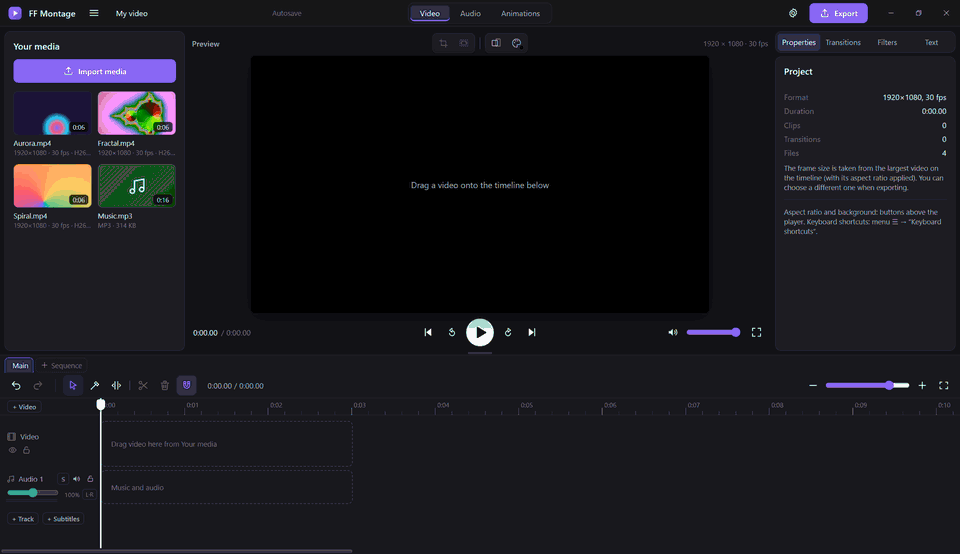

<p align="center">
  
</p>

<h1 align="center">FF Montage</h1>
<h3 align="center">Бесплатный видеоредактор с открытым кодом и FFmpeg под капотом.</h3>

<div align="center">



<p align="center">
  <a href="https://github.com/IsselSaizo/FFMontage/releases/latest"></a>
  <a href="https://github.com/IsselSaizo/FFMontage/releases"></a>
  <a href="https://github.com/IsselSaizo/FFMontage/actions/workflows/ci.yml"></a>
  <a href="#скачать"></a>
  <a href="../../LICENSE"></a>
</p>

<p align="center">
  <a href="https://github.com/IsselSaizo/FFMontage/releases/latest"></a>
</p>

[🇬🇧 English](../../README.md) · **🇷🇺 Русский** · [🇩🇪 Deutsch](README.de.md) · [🇨🇳 简体中文](README.zh-Hans.md) · [🇯🇵 日本語](README.ja.md)

</div>

## О программе

FF Montage — бесплатный видеоредактор с открытым кодом для Windows, Linux и Steam Deck. Предпросмотр проигрывает
исходники как есть, а готовое видео собирает **FFmpeg** — в исходном разрешении и частоте кадров (1440p60 остаётся
1440p60), в AV1, HEVC или H.264, на видеокарте (NVIDIA NVENC, Intel QSV, AMD AMF, VA-API на Linux), если она есть,
иначе на процессоре.

Без водяного знака, без учётной записи, без подписки, без загрузки в облако. Всё работает на вашем компьютере:
программа — один файл на [Tauri 2](https://tauri.app) (Rust + системный WebView), FFmpeg лежит рядом.

**Подходит для:** роликов на YouTube и игровых клипов (записи NVIDIA / OBS с несколькими звуковыми дорожками
открываются как есть), Shorts / Reels / TikTok в 9:16, уроков и записей экрана, интервью и подкастов, видео
с субтитрами, мастер-копий для эфира.

**И для машин:** встроенный MCP-сервер позволяет Claude, Cursor и другим ИИ-ассистентам монтировать за вас, а API
плагинов в песочнице позволяет любому добавлять эффекты, переходы, панели и пресеты.

Версия 0.4.7. Что нового — в [CHANGELOG.md](../../CHANGELOG.md).

## Главное

- 🚫 **Без водяного знака. Без учётной записи. Без платных функций.** Свободная программа под GPL-3.0.
- 🔒 **Всё локально.** Ничего не загружается в сеть, работает без интернета. ИИ-ассистент общается только с программой на этом компьютере.
- ⚡ **Экспорт FFmpeg на видеокарте.** NVENC, QSV, AMF, VA-API или процессор. AV1, HEVC, H.264, вплоть до исходного разрешения и частоты кадров.
- 🎞️ **Открывает то, что вы записали.** H.264, HEVC и AV1 играют без конвертации; MKV, TS, AVI и остальное автоматически перепаковываются или получают прокси.
- ✂️ **Настоящие инструменты монтажа.** Лезвие, обрезка со сдвигом, прокрутка, сдвиг содержимого и скольжение (ripple / roll / slip / slide), метки входа и выхода, подъём и извлечение, шаттл JKL, магнитный таймлайн.
- 🧱 **Много дорожек.** Видеодорожки как слои с трансформом и кадрированием, сколько угодно звуковых дорожек, дорожки субтитров, несколько таймлайнов (эпизодов) в одном проекте.
- 📝 **Титры и субтитры.** Текст выглядит одинаково в предпросмотре и в экспорте; импорт и экспорт SRT / VTT / ASS.
- 🎚️ **Нормальный звук.** Эквалайзер, компрессор, шумодав, плагины VST3 и CLAP, индикаторы уровня, нормализация громкости в два прохода, 5.1 / 7.1 / N моноканалов.
- 📤 **Много форматов.** MP4, MKV, MOV, GIF, MP3, M4A, WAV, OGG, а также мастер-копии ProRes / DNxHR / XDCAM с таймкодом.
- 🧩 **Плагины.** Эффекты, переходы, стили текста, пресеты экспорта и горячих клавиш, действия и панели — всё в песочнице.
- 🤖 **ИИ-ассистент (MCP).** Попросите Claude вырезать паузы, подложить музыку под видео и экспортировать его в 1080p.
- ⌨️ **Ваши горячие клавиши.** Пресеты Premiere Pro, DaVinci Resolve и CapCut плюс свои сочетания; геймпад и сенсорный экран на Steam Deck.
- 🌍 **Интерфейс на русском и английском**, переключается без перезапуска.

## Возможности

### Медиатека
- Импорт кнопкой или перетаскиванием. **H.264, HEVC и AV1** открываются без конвертации, если WebView умеет их
  декодировать; программа не гадает, а спрашивает об этом сам WebView.
- **MKV, TS, M2TS, AVI** и другие контейнеры: если кодек проигрывается, поток перепаковывается в MP4 без перекодирования
  (секунды, исходное качество); иначе создаётся прокси 720p. **В экспорт всегда идёт оригинал.**
- Записи с **несколькими звуковыми потоками** (игра + микрофон из NVIDIA ShadowPlay / OBS): каждый поток попадает
  в свой связанный звуковой клип.
- Картинки (JPG, PNG, WebP, BMP) и анимированные GIF.

### Таймлайн
- Перестановка, обрезка за края, разрезание (`S`, `Alt+S` — всё под курсором), лезвие (`B`, `Shift`+щелчок режет
  все дорожки), магнит, наложение и вставка (`Alt`), пустоты и их удаление, отмена и повтор, масштаб.
- **Инструмент «Обрезка» (`T`)**: край клипа — **обрезка со сдвигом** (ripple), стык двух клипов — **прокрутка** (roll),
  нижняя половина — **сдвиг содержимого** (slip), верхняя — **скольжение** (slide). Предпросмотр показывает оба кадра
  по сторонам склейки.
- **Метки входа и выхода** (`I` / `O`), **подъём** (`;`) и **извлечение** (`'`), обрезка до курсора (`Q` / `W`).
- **Шаттл JKL**: `L` — вперёд ×1 → ×2 → ×4 → ×8, `J` — назад, `K` — стоп; `K` + `J` / `L` — шаг на кадр.
- **«Удалить паузы…»**: тихие места (FFmpeg `silencedetect`) вырезаются вместе с видео, всё остальное сдвигается.
- **Эпизоды**: несколько таймлайнов в одном проекте.
- Мышь: колесо — прокрутка по времени, `Shift` + колесо — прокрутка дорожек, `Ctrl` + колесо — масштаб.

### Видео
- **Несколько видеодорожек**: порядок задаёт слои; каждую дорожку можно скрыть или заблокировать.
- **Трансформ**: положение, масштаб, поворот, прозрачность — гизмо прямо в плеере (с прилипанием к центру и краям)
  или полями в инспекторе. **Кадрирование** — рамкой в плеере.
- **Скорость** ×0.1–×16 (тон звука сохраняется), реверс, стоп-кадр.
- **20 переходов** (0,1–3 с), **фильтры** (ч/б, сепия, контраст, размытие…), **формат кадра** 16:9, 9:16, 1:1,
  3:4 с фоном, вписать / заполнить / растянуть.
- Вкладка **«Анимации»**: пресет «Дождь» с живым предпросмотром, запекается в WebM с прозрачностью.
- «Картинка в картинке» и раскладки сеткой — пример-плагин `examples/plugins/layouts`.

### Текст и субтитры
- Заголовок, нижняя плашка, подпись, бегущие титры, простой текст. Шрифт, цвет, обводка, тень, подложка, выравнивание.
- Встроены Inter и Open Sans (с кириллицей); свои шрифты `.ttf` / `.otf` добавляются в программе.
  **В плеере и в готовом видео текст выглядит одинаково.**
- **Дорожки субтитров**: импорт и сохранение SRT / VTT / ASS (кодировка — по BOM, иначе UTF-8, иначе cp1251), правка
  реплик на таймлайне. В экспорте — вшить (libass) или отдельным потоком.

### Звук
- Звук видео — отдельными связанными клипами, дорожки музыки и голоса, громкость клипа и дорожки 0–200 %, соло,
  без звука, блокировка, затухания.
- Вкладка **«Аудио»**: эквалайзер, компрессор и шумодав на клип или на всю дорожку. **Плагины VST3 и CLAP** (Windows x64)
  в той же цепочке; окно плагина открывается отдельно, упавший плагин не роняет программу.
- **Индикаторы уровня** на каждой дорожке и на общем миксе (красный — выше −1 dBFS).
- **Нормализация громкости** в два прохода: «Интернет −14 LUFS», «Подкаст −16 LUFS», «Эфир −23 LUFS (EBU R128)».
- **Многоканальные проекты**: стерео, моно, 5.1, 7.1 или до 16 отдельных моноканалов; матрица распределения
  «дорожка → каналы», «Разложить по каналам» для многоканальных клипов; плеер воспроизводит стереосведение.

### Экспорт
- Видео: **MP4, MKV, MOV, GIF**; только звук: **MP3, M4A, WAV, OGG**. Разрешение от 480p до исходного,
  прогресс и отмена, полная команда FFmpeg — в `<кэш>/app/logs/last-export.log`.
- **AV1, HEVC, H.264** на NVIDIA NVENC, Intel QSV, AMD AMF, VA-API или на процессоре (SVT-AV1, x265, x264).
- В MKV и MOV можно записать **каждую звуковую дорожку отдельным потоком** (сначала микс, затем каждая дорожка по имени).
- **«Мастер-копия»**: Apple ProRes 422 / HQ / 4444, Avid DNxHR SQ / HQ / HQX, Sony XDCAM HD422 (MXF), PCM 24 бит,
  начальный **таймкод** (drop-frame, где нужно).
- Каждая команда FFmpeg проверяется в Rust перед запуском: входы — только из проекта, выход — только в выбранный вами файл.

### Плагины
- Плагин — это папка с `plugin.json`: **эффекты, переходы, звуковые эффекты, стили текста, пресеты экспорта
  и горячих клавиш, цели громкости, действия и панели**. Встроенные эффекты — тоже плагин (`core`) на том же API.
- Плагины работают в песочнице (iframe без доступа к программе, файлам и FFmpeg). Эффекты описывают фильтры FFmpeg
  декларативно; проходят только фильтры из белого списка, а Rust ещё раз проверяет весь граф.
- Установка из папки, из zip или прямо с GitHub (`owner/repo`, с проверкой SHA-256); права показываются до установки.
  Руководство — [docs/Guides/PLUGINS.md](../Guides/PLUGINS.md), примеры — [`examples/plugins`](../../examples/plugins).

### Остальное
- **Горячие клавиши** с пресетами «Родные (FF Montage) / DaVinci Resolve / Premiere Pro / CapCut», свои сочетания поверх,
  поиск конфликтов, экспорт и импорт JSON — полная таблица в [docs/Guides/HOTKEYS.md](../Guides/HOTKEYS.md).
- **Steam Deck**: управление с геймпада (A — пуск, X — разрезать, B — отменить, LB / RB — кадры, LT / RT — шаттл…),
  крупные ручки для пальцев, раскладка под 1280×800.
- Автосохранение, проект в одном файле `.ffproj`, portable-режим, подписанные обновления из самой программы.
- **Отчёты о сбоях** остаются на вашем диске (`logs/reports`), никуда не отправляются.

## Скачать

| | Windows | Linux |
|---|---|---|
| Система | Windows 10 / 11 x64 | x86_64, glibc 2.35+ (Ubuntu 22.04+, Arch, SteamOS) |
| Окно | WebView2 (есть в Windows 11 и обновлённой 10) | WebKitGTK 4.1, GStreamer good (звук и видео в предпросмотре) |
| FFmpeg | в архиве релиза | в архиве релиза / AppImage |
| Экран | от 1280×800 | от 1280×800 |

macOS и ARM пока не поддерживаются (в планах, см. [ROADMAP](../Works/ROADMAP.md)).

### Готовая сборка

1. Откройте **[Releases](https://github.com/IsselSaizo/FFMontage/releases/latest)** и скачайте
   `FF-Montage-<версия>-windows-x64.zip` (Windows) или `FF-Montage-<версия>-linux-x86_64.tar.gz` (Linux; для
   Steam Deck и других дистрибутивов проще AppImage — см. ниже).
2. Распакуйте в любую папку, где можно писать (например, `D:\FF Montage`).
3. Запустите **`FF Montage.exe`** (Linux: `./ff-montage`). FFmpeg уже внутри архива.

Windows может написать «Система Windows защитила ваш компьютер» — нажмите **Подробнее** › **Выполнить в любом случае**
(у программы нет сертификата подписи кода).
Linux: `sudo apt install libwebkit2gtk-4.1-0 gstreamer1.0-plugins-good` (Ubuntu 22.04+),
Arch: `sudo pacman -S webkit2gtk-4.1 gst-plugins-good`.

**Где хранятся данные.** Zip-сборка Windows в папке с правом записи работает в **portable-режиме**: настройки, свои шрифты,
плагины и кэш лежат рядом с программой, папку можно переносить целиком. В остальных случаях (Linux, папка только
для чтения, Program Files) используются системные папки: Windows — `%APPDATA%\FF Montage` и `%LOCALAPPDATA%\FF Montage`,
Linux — `~/.config/ff-montage`, `~/.local/share/ff-montage`, `~/.cache/ff-montage`.
Portable-режим включается и вручную: файл `portable.txt` рядом с программой или переменная `FFM_PORTABLE=1`
(`FFM_PORTABLE=0` — выключить). Текущие пути показаны в **«Настройки» → «О программе»**.

**Обновление:** меню ☰ → **«Проверить обновления…»**. Программа скачивает архив своей системы из последнего релиза
и ставит его, только если подпись `SHA256SUMS` верна и SHA-256 архива совпадает. Настройки и проекты не затрагиваются.
Проверить файлы вручную: `sha256sum -c SHA256SUMS --ignore-missing`.

### Linux и Steam Deck: AppImage

`FF-Montage-<версия>-linux-x86_64.AppImage` — один файл, внутри всё нужное: окно (WebKitGTK), GStreamer для видео
и звука в плеере, FFmpeg. Ничего ставить не нужно, `sudo` не нужен.

1. Скачайте AppImage из [Releases](https://github.com/IsselSaizo/FFMontage/releases/latest), например в `~/Applications`.
2. Сделайте файл исполняемым: `chmod +x FF-Montage-*.AppImage` (или в Dolphin: правый щелчок → «Свойства» →
   «Права» → «Является исполняемым»).
3. Запустите двойным щелчком или `./FF-Montage-<версия>-linux-x86_64.AppImage`.

**Steam Deck.** Удобнее всего в **режиме рабочего стола** (кнопка питания → «Переключиться на рабочий стол»): там есть
клавиатура и мышь / тачпад, файлы видно в Dolphin. Чтобы запускать из игрового режима: Steam (на рабочем столе) →
«Игры» → «Добавить стороннюю игру в мою библиотеку…» → «Обзор…» → выбрать AppImage (фильтр «Все файлы») →
«Добавить выбранные программы». Окно рассчитано на 1280×800; в игровом режиме для текста и горячих клавиш нужна
экранная клавиатура (Steam + X) или подключённая клавиатура.

- Данные — в папках XDG (`~/.config/ff-montage`, `~/.local/share/ff-montage`, `~/.cache/ff-montage`): сам AppImage
  только для чтения. Папки кэша, экспорта и проектов выбираются при первом запуске (на Deck удобно — на SD-карте).
- **Обновление** («Проверить обновления…») скачивает новый AppImage, проверяет подпись и SHA-256 и подменяет
  **тот же файл** (имя не меняется, ярлык в Steam продолжает работать). Папка с AppImage должна быть доступна на запись.
- Если AppImage не запускается из-за FUSE (на SteamOS FUSE есть, на некоторых системах — нет):
  `./FF-Montage-….AppImage --appimage-extract-and-run` или установите `libfuse2`.
- Диагностика: `./FF-Montage-….AppImage --engine info </dev/null` — покажет, откуда взят FFmpeg, какие плагины GStreamer
  найдены и куда пишутся данные.
- Аппаратный экспорт на Deck — VA-API (`h264_vaapi`, `hevc_vaapi`); AV1 видеокарта Deck не кодирует, поэтому AV1 идёт
  на процессоре.

### Из исходников

```powershell
git clone https://github.com/IsselSaizo/FFMontage.git
cd FFMontage
.\setup.cmd          # Linux: ./setup.sh
```

`setup` скачивает FFmpeg в папку `ffmpeg\` (закреплённая сборка, проверка SHA-256), ставит Rust (на Windows при
необходимости — Visual Studio Build Tools через winget), собирает программу в **`FF Montage.exe`** и кладёт ярлык
на рабочий стол. Первая сборка занимает 3–6 минут. В git-клоне «Проверить обновления…» делает `git pull`
и пересобирает программу.

- Если FFmpeg уже есть: `.\setup.cmd -SkipFFmpeg`. Папку с ним можно указать при первом запуске.
- Без видеокарты экспорт идёт на процессоре (libsvtav1 / libx265 / libx264): медленнее, результат тот же.

## Первый запуск

Программа покажет окно выбора папок:

| Папка | Что там |
|---|---|
| **Кэш** | миниатюры, волны звука, прокси, данные окна, автосохранение, журналы |
| **Экспорт** | готовые видео |
| **Проекты** | файлы `.ffproj` |
| **FFmpeg** | можно оставить пустым: программа найдёт его сама (папка `ffmpeg` рядом с программой, соседние папки `ffmpeg-*`, `PATH`) |

Папки сохраняются в `config.json`, настройки интерфейса — в `settings.json` (оба лежат в папке настроек, см.
«Где хранятся данные»). Поменять папки можно в **«Настройки» → «Папки»**; если удалить `config.json`, окно первого
запуска появится снова.

## Настройки

Меню ☰ → **«Настройки…»** (`Ctrl+,`):

- **Общие** — язык (русский / English), открывать ли последний проект при запуске.
- **Горячие клавиши** — пресет, свои сочетания, поиск, конфликты, экспорт и импорт JSON.
- **Плагины** — установка из папки, zip или GitHub; включение, права, удаление.
- **Аудиоплагины (VST3, CLAP)** — папки, сканирование, добавление плагина.
- **Папки**, **Кэш** (размеры, очистка по категориям, лимит), **ИИ-ассистент**, **О программе** (версии, пути,
  обновления, отчёты о сбоях).

## ИИ-ассистент (MCP)

FF Montage подключается к ИИ-ассистентам по протоколу MCP (Model Context Protocol). Claude Desktop, Cursor, VS Code
или Claude Code могут импортировать файлы, резать и переставлять клипы, добавлять дорожки, текст и субтитры, менять
трансформ, ставить переходы, «смотреть» кадры, искать паузы, настраивать звуковые каналы, сохранять проект
и экспортировать видео.

**Подключение.** Меню ☰ → **«ИИ-ассистент (MCP)…»** — там готовый JSON с кнопкой «Скопировать».

- Claude Desktop: Settings → Developer → Edit Config, вставьте блок в `claude_desktop_config.json` (если там уже
  есть `"mcpServers"`, добавьте только `"ff-montage"`), перезапустите Claude.
- Cursor: тот же блок в `~/.cursor/mcp.json` (или `.cursor/mcp.json` в папке проекта).
- VS Code: блок для `.vscode/mcp.json` (ключ `"servers"`) — во втором поле окна.
- Claude Code: готовая команда `claude mcp add …` — в третьем поле.

Сервер — сама программа с ключом `--mcp` (`"FF Montage.exe" --mcp`). Если FF Montage закрыт, ассистент запустит его
сам (папки должны быть уже выбраны при первом запуске).

**Примеры просьб:**

- «Импортируй видео из D:\Записи\Отпуск и собери ролик по порядку, между клипами — растворение».
- «Найди в интервью паузы длиннее секунды и вырежи их».
- «Положи музыку C:\Music\track.mp3 на весь ролик, громкость 40 %, затухание в конце 3 с».
- «Добавь заголовок „Отпуск 2026“ на первые 4 секунды».
- «Сохрани проект и экспортируй в 1080p H.264».

**Безопасность.** Ассистент меняет открытый проект: каждое действие видно на таймлайне и отмечается уведомлением
«ИИ: …», любую правку можно отменить `Ctrl+Z`. Несохранённый проект он без явного разрешения не закроет. Команды
принимаются только с этого компьютера (именованный канал / unix-сокет, без сети) и только с секретным ключом из
`<кэш>/app/mcp-endpoint.json`; ключ создаётся заново при каждом запуске и удаляется при выходе.

## Горячие клавиши

По умолчанию: пробел — пуск / пауза, `S` — разрезать, `Alt+S` — разрезать всё под курсором, `B` / `A` — лезвие /
выделение, `T` — обрезка, `Delete` / `Shift+Delete` — удалить / удалить со сдвигом, `Ctrl+Z` / `Ctrl+Y` — отменить /
повторить, `←` `→` — на кадр (с `Shift` — на секунду), `J` `K` `L` — шаттл, `I` / `O` — метки.
Полная таблица по всем пресетам — [docs/Guides/HOTKEYS.md](../Guides/HOTKEYS.md).

## Как поддержать FF Montage

> [!IMPORTANT]
> **Лучшая поддержка — просто пользоваться FF Montage так, как удобно *вам*.** Монтируйте в нём свои ролики,
> подстраивайте его под себя: меняйте горячие клавиши, выбирайте пресет, добавляйте свои шрифты, подключайте свои
> эффекты VST3 / CLAP, отдавайте рутину ИИ-ассистенту.
>
> **Сделайте его своим с помощью плагинов.** Не хватает эффекта, перехода, стиля текста, пресета экспорта или целой
> панели? Напишите плагин — как это сделать, показывают [docs/Guides/PLUGINS.md](../Guides/PLUGINS.md) и
> [`examples/plugins`](../../examples/plugins), а установить плагин можно прямо из репозитория на GitHub. Поделитесь
> им — и FF Montage станет лучше для всех.
>
> Нашли, где что-то ломается или могло бы работать лучше? [Создайте issue](https://github.com/IsselSaizo/FFMontage/issues) —
> достаточно короткого описания и отчёта из `logs/reports`. Звёздочка ⭐ на GitHub помогает другим найти проект.

## Разработка

```text
src-tauri/      программа на Rust: окна, пути и настройки, FFmpeg (анализ, миниатюры, волна, прокси, реверс,
                стоп-кадр), проверка и запуск экспорта, протоколы media:// и plugin://, плагины, шрифты,
                хост аудиоплагинов (src/vst), MCP-сервер (--mcp), обновления, отчёты о сбоях
src/renderer/   интерфейс: медиатека, плеер, таймлайн, инспектор, экспорт, настройки; js/exportPlan.js собирает
                команду FFmpeg, js/keymap.js — действия и клавиши, js/plugins/ — хост плагинов
mcp/tools.json  инструменты ИИ-ассистента
examples/       примеры плагинов
tests/          тесты движка, MCP, звука, субтитров, реестра и автотесты интерфейса
tools/          setup, скачивание FFmpeg, подпись релиза, таблица горячих клавиш, проверка версии
docs/           Guides (PLUGINS.md, HOTKEYS.md), Works (ROADMAP, аудиты), ReadMEs (переводы README)
.github/        CI на каждый push, релиз по тегу v*, сборка AppImage
```

**Сборка:** `cd src-tauri && cargo build --release` → `src-tauri/target/release/ff-montage(.exe)`.
Интерфейс встраивается в exe при сборке: после правок в `src/renderer` нужно пересобрать.
Нужен Rust stable; на Linux ещё `libwebkit2gtk-4.1-dev libgtk-3-dev librsvg2-dev`.

**Тесты:**

| Команда | Что проверяет |
|---|---|
| `cd src-tauri && cargo test` | проверка плана экспорта, плагины, пути, обновления (SHA256SUMS, подпись, выбор архива, версии) |
| `node tests/engine-test.js` | экспорт во все кодеки, по цвету пикселей: пустоты, переходы, затухания, дорожки, текст, субтитры |
| `node tests/audio-test.js` | громкость, раскладки каналов, распределение по каналам, мастер-копии для эфира |
| `node tests/mcp-test.js` | ИИ-ассистент (нужны файлы от engine-test; отдельный кэш) |
| `node tests/subtitles-test.js`, `registry-test.js`, `ffescape-test.js`, `layouts-test.js` | субтитры, реестр, экранирование, пример-плагин |
| `node tests/i18n-check.js` | все строки интерфейса переведены |
| `node tools/syntax-check.mjs` | синтаксис всех модулей окна без запуска |
| `powershell -ExecutionPolicy Bypass -File tests\run-ui.ps1 ui-selftest3` | автотест интерфейса (Windows, отдельный кэш) |
| `bash tools/appimage-smoke.sh <файл.AppImage>` | AppImage: FFmpeg и GStreamer внутри, FFmpeg берётся из образа, пути XDG, `$APPIMAGE` |
| `bash tools/appimage-window.sh <файл.AppImage или ff-montage>` | окно под xvfb: `<video>` через GStreamer |

С `FFM_NO_GPU=1` программа ведёт себя как компьютер без видеокарты (так тесты идут в CI).
CI также проверяет `cargo fmt --check`, `cargo clippy`, актуальность `docs/Guides/HOTKEYS.md`
(`node tools/hotkeys-doc.mjs`) и одинаковую версию в `Cargo.toml`, `tauri.conf.json` и `package.json`
(`node tools/check-version.mjs`).

**Перевод:** исходный язык интерфейса — русский; строка в коде и есть ключ (`t('Новый проект')`), английские
переводы лежат в `src/renderer/js/i18n/en/*.js`, в Rust — `tr!("…", "…")`. Переводы README — в
[`docs/ReadMEs`](.).

**Выпуск релиза:** поднять версию в `src-tauri/Cargo.toml`, `src-tauri/tauri.conf.json`, `package.json` (и
`Cargo.lock`), дополнить `CHANGELOG.md`, затем `git tag v0.4.7 && git push origin v0.4.7`. Workflow проверит, что
тег совпадает с версией, соберёт архивы, посчитает `SHA256SUMS` и подпишет его ключом из секрета
`FFM_SIGNING_KEY` (`tools/sign-release.mjs`). Без верной подписи программа обновление не установит.

**AppImage** (`.github/workflows/appimage.yml`) собирается на каждый push в `main` и в каждом релизе: tauri-cli
с дополнительным конфигом `.github/appimage.conf.json` (`bundleMediaFramework` — GStreamer внутри, FFmpeg BtbN
по SHA-256 в `usr/bin/ffmpeg/bin`), затем дымовой тест и окно под xvfb. Если сборка AppImage сломалась из-за внешних
инструментов (linuxdeploy), выпустить релиз без него можно переменной репозитория `FFM_APPIMAGE=0`. На Linux
`<video>` / `<audio>` получают файлы по HTTP с 127.0.0.1 (случайный порт и токен, `protocol.rs`): GStreamer
в WebKitGTK не открывает свои схемы вроде `media://`.

## Лицензия

FF Montage — свободная программа под [GPL-3.0](../../LICENSE). FFmpeg — GPL (сборки [BtbN](https://github.com/BtbN/FFmpeg-Builds)
`gpl`), Tauri — MIT / Apache-2.0. Шрифты Inter и Open Sans (`fonts/`) — SIL OFL 1.1.
Аудиоплагины: привязки [vst3](https://github.com/coupler-rs/vst3-rs) (MIT / Apache-2.0, по VST 3 SDK — MIT)
и [clap-sys](https://github.com/micahrj/clap-sys) (MIT / Apache-2.0, CLAP — MIT). VST — товарный знак Steinberg
Media Technologies GmbH; логотип VST программа не использует. Сами плагины пользователь ставит отдельно, со своими
лицензиями; программа их не распространяет.

FF Montage — независимый проект, он не связан с проектом FFmpeg и не одобрен им. FFmpeg — товарный знак
Фабриса Беллара.

## DMCA

Код, интерфейс и документация FF Montage написаны для этого проекта; сторонние компоненты перечислены выше вместе
с лицензиями. Если вы всё же считаете, что что-то в этом репозитории или его релизах нарушает ваши авторские права,
создайте [issue](https://github.com/IsselSaizo/FFMontage/issues/new?title=Copyright%20notice) с заголовком
«Copyright notice» — личные данные в issue указывать не нужно, мы ответим и дадим контакт для личной переписки, —
или отправьте уведомление в GitHub по его [правилам DMCA](https://docs.github.com/en/site-policy/content-removal-policies/dmca-takedown-policy).
В уведомлении нужно указать произведение, которое вам принадлежит, дать ссылку на материал здесь, указать свои
контакты и заявить, что вы добросовестно считаете это использование неразрешённым, что уведомление точно и что вы
правообладатель или вправе действовать от его имени. Обоснованные уведомления рассматриваются быстро; автор удалённого
материала может тем же способом отправить встречное уведомление.
