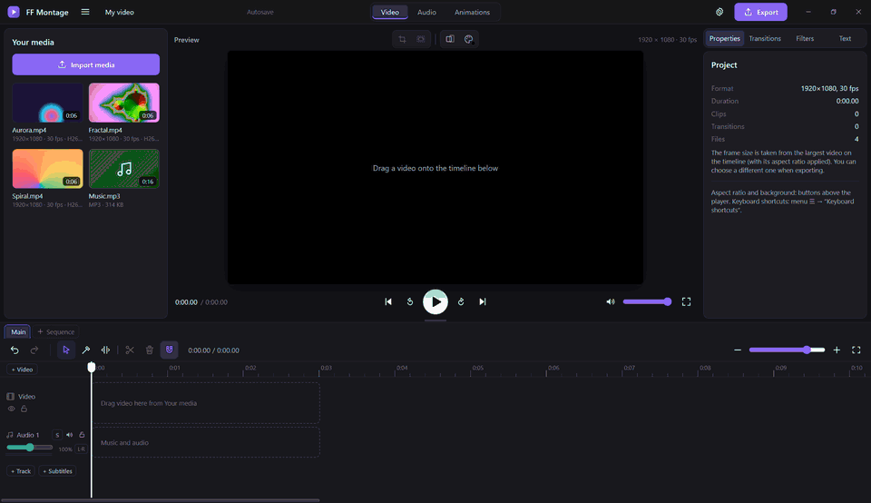

<p align="center">
  
</p>

<h1 align="center">FF Montage</h1>
<h3 align="center">一款免费、开源、以 FFmpeg 为核心的视频编辑器。</h3>

<div align="center">



<p align="center">
  <a href="https://github.com/IsselSaizo/FFMontage/releases/latest"></a>
  <a href="https://github.com/IsselSaizo/FFMontage/releases"></a>
  <a href="https://github.com/IsselSaizo/FFMontage/actions/workflows/ci.yml"></a>
  <a href="#下载"></a>
  <a href="../../LICENSE"></a>
</p>

<p align="center">
  <a href="https://github.com/IsselSaizo/FFMontage/releases/latest"></a>
</p>

[🇬🇧 English](../../README.md) · [🇷🇺 Русский](README.ru.md) · [🇩🇪 Deutsch](README.de.md) · **🇨🇳 简体中文** · [🇯🇵 日本語](README.ja.md)

</div>

## 关于

FF Montage 是一款适用于 Windows、Linux 和 Steam Deck 的免费开源视频编辑器。预览会按原样播放你的素材，成片则由 **FFmpeg** 合成：保持源分辨率和帧率（1440p60 仍是 1440p60），编码为 AV1、HEVC 或 H.264；有显卡时使用显卡（NVIDIA NVENC、Intel QSV、AMD AMF，Linux 上为 VA-API），没有显卡时使用 CPU。

没有水印，无需账号，无需订阅，无需上传。一切都在你的电脑上运行：程序是基于 [Tauri 2](https://tauri.app)（Rust + 系统 WebView）构建的单个文件，FFmpeg 就放在它旁边。

**适用于：** YouTube 视频和游戏片段（带多条音轨的 NVIDIA / OBS 录像可直接按原样打开）、9:16 的 Shorts / Reels / TikTok、教程和录屏、访谈和播客、带字幕的视频、广播母版。

**也适用于机器：** 内置的 MCP 服务器让 Claude、Cursor 和其他 AI 助手可以替你剪辑，而沙箱化的插件 API 让任何人都能添加效果、转场、面板和预设。

版本 0.4.7。更新内容：[CHANGELOG.md](../../CHANGELOG.md)（俄文）。

## 亮点

- 🚫 **没有水印。无需账号。没有付费墙。** 基于 GPL-3.0 的自由软件。
- 🔒 **100% 本地运行。** 不上传任何内容；可离线使用。AI 助手只与本机上的程序通信。
- ⚡ **FFmpeg 在 GPU 上导出。** NVENC、QSV、AMF、VA-API 或 CPU。AV1、HEVC、H.264，最高可达源分辨率和帧率。
- 🎞️ **直接打开你录制的内容。** H.264、HEVC 和 AV1 无需转换即可播放；MKV、TS、AVI 等格式会自动重新封装或生成代理文件。
- ✂️ **真正的剪辑工具。** 刀片、波纹 / 滚动 / 外滑 / 内滑修剪、入点 / 出点标记、提升 / 提取、JKL 穿梭、磁性时间线。
- 🧱 **多轨道。** 视频轨道作为图层，支持变换和裁剪；任意数量的音频轨道、字幕轨道；一个项目中可包含多条时间线（剧集）。
- 📝 **标题与字幕。** 文字在预览和导出中效果完全一致；支持 SRT / VTT / ASS 导入与导出。
- 🎚️ **专业的声音处理。** 均衡器、压缩器、降噪、VST3 和 CLAP 插件、电平表、两遍响度标准化、5.1 / 7.1 / N 个单声道声道。
- 📤 **多种格式。** MP4、MKV、MOV、GIF、MP3、M4A、WAV、OGG，以及带时间码的 ProRes / DNxHR / XDCAM 母版。
- 🧩 **插件。** 效果、转场、文字样式、导出与快捷键预设、操作和面板，全部运行在沙箱中。
- 🤖 **AI 助手（MCP）。** 让 Claude 剪掉停顿、给视频配上音乐并以 1080p 导出。
- ⌨️ **你的快捷键。** Premiere Pro、DaVinci Resolve 和 CapCut 预设，外加自定义快捷键；在 Steam Deck 上支持手柄和触控。
- 🌍 **英文和俄文界面**，无需重启即可切换（暂无中文界面）。

## 功能

### 媒体
- 通过按钮或拖放导入。当 WebView 能够解码时，**H.264、HEVC 和 AV1** 无需转换即可打开；程序会直接询问 WebView，而不是靠猜测。
- **MKV、TS、M2TS、AVI** 等容器：如果编解码器可以播放，流会被重新封装（remux）为 MP4，不重新编码（只需几秒，保持源画质）；否则会生成 720p 代理文件。**导出始终使用原始文件。**
- 带有**多条音频流**的录像（来自 NVIDIA ShadowPlay / OBS 的游戏声音 + 麦克风）：每条流都会放到各自的链接音频片段上。
- 图片（JPG、PNG、WebP、BMP）和 GIF 动图。

### 时间线
- 移动、拖动边缘修剪、分割（`S`；`Alt+S` 分割播放头下的所有片段）、刀片（`B`；`Shift`+单击切开所有轨道）、磁吸、覆盖与插入（`Alt`）、间隙与闭合间隙、撤销 / 重做、缩放。
- **修剪工具（`T`）**：片段边缘为**波纹**（ripple），两个片段之间的接缝为**滚动**（roll），下半部分为**外滑**（slip），上半部分为**内滑**（slide）。预览会同时显示剪辑点两侧的画面。
- **入点 / 出点标记**（`I` / `O`）、**提升**（`;`）和**提取**（`'`），修剪到播放头（`Q` / `W`）。
- **JKL 穿梭**：`L` 向前播放 ×1 → ×2 → ×4 → ×8，`J` 向后播放，`K` 停止；`K` + `J` / `L` 逐帧步进。
- **Remove pauses…**（删除停顿）：静音部分（FFmpeg `silencedetect`）会连同视频一起被剪掉，其余内容自动前移。
- **剧集**：一个项目中可包含多条时间线。
- 鼠标：滚轮沿时间方向滚动，`Shift` + 滚轮滚动轨道，`Ctrl` + 滚轮缩放。

### 视频
- **多条视频轨道**：轨道顺序决定图层的叠放顺序；每条轨道都可以隐藏或锁定。
- **变换**：位置、缩放、旋转、不透明度——可直接在播放器中用控制手柄调整（会吸附到中心和边缘），也可在检查器中输入数值。在播放器中拖动边框进行**裁剪**。
- **速度** ×0.1–×16（保持音高）、倒放、定格帧。
- **20 种转场**（0.1–3 秒）、**滤镜**（黑白、棕褐色、对比度、模糊……）、**画幅** 16:9、9:16、1:1、3:4，可带背景，支持适应 / 填充 / 拉伸。
- **Animations**（动画）选项卡：“Rain”（雨）预设，带实时预览，烘焙为带透明通道的 WebM。
- 画中画和网格布局——见示例插件 `examples/plugins/layouts`。

### 文字与字幕
- 标题、下方字幕条、说明文字、滚动字幕、纯文本。字体、颜色、描边、阴影、背景板、对齐方式。
- 内置 Inter 和 Open Sans 字体（含西里尔字母）；可在程序中添加你自己的 `.ttf` / `.otf` 字体。**文字在播放器中和成片中的效果完全一致。**
- **字幕轨道**：导入和保存 SRT / VTT / ASS（编码依据 BOM 判断，否则为 UTF-8，再否则为 cp1251），在时间线上编辑字幕行。导出：烧录到画面中（libass）或作为单独的流。

### 声音
- 视频的声音作为单独的链接片段，音乐和人声轨道，片段和轨道音量 0–200%，独奏、静音、锁定、淡入淡出。
- **Audio**（音频）选项卡：可对单个片段或整条轨道使用均衡器、压缩器和降噪。**VST3 和 CLAP 插件**（Windows x64）位于同一效果架中；插件窗口单独打开，插件崩溃也不会导致程序崩溃。
- 每条轨道和总混音都有**电平表**（高于 −1 dBFS 时显示红色）。
- 两遍**响度标准化**：“Web −14 LUFS”、“Podcast −16 LUFS”、“Broadcast −23 LUFS (EBU R128)”。
- **多声道项目**：立体声、单声道、5.1、7.1 或最多 16 个独立的单声道声道；“track → channels”（轨道 → 声道）路由矩阵，多声道片段可使用 “Split into channels”（拆分为声道）；播放器监听的是立体声缩混。

### 导出
- 视频：**MP4、MKV、MOV、GIF**；仅音频：**MP3、M4A、WAV、OGG**。分辨率从 480p 到源分辨率，显示进度并可取消，完整的 FFmpeg 命令保存在 `<cache>/app/logs/last-export.log`。
- **AV1、HEVC、H.264**，可使用 NVIDIA NVENC、Intel QSV、AMD AMF、VA-API 编码，或使用 CPU（SVT-AV1、x265、x264）。
- MKV 和 MOV 可以把**每条音轨作为独立的流**写入（先是混音，然后按名称依次是各条轨道）。
- **Master file**（母版文件）：Apple ProRes 422 / HQ / 4444、Avid DNxHR SQ / HQ / HQX、Sony XDCAM HD422（MXF）、24 位 PCM，起始**时间码**（需要时使用丢帧时间码）。
- 每条 FFmpeg 命令在运行前都会经过 Rust 检查：输入只能来自项目，输出只能写入你选择的文件。

### 插件
- 插件就是一个包含 `plugin.json` 的文件夹：**效果、转场、音频效果、文字样式、导出与快捷键预设、响度目标、操作和面板**。内置效果本身也是一个基于同一 API 的插件（`core`）。
- 插件在沙箱中运行（一个无法访问程序、文件或 FFmpeg 的 iframe）。效果以声明方式描述 FFmpeg 滤镜；只有白名单中的滤镜才能通过，并且 Rust 会再次检查整个滤镜图。
- 可从文件夹、zip 压缩包或直接从 GitHub 安装（`owner/repo`，校验 SHA-256）；安装前会显示所需权限。指南：[docs/Guides/PLUGINS.md](../Guides/PLUGINS.md)，示例：[`examples/plugins`](../../examples/plugins)。

### 其他
- **快捷键**：提供 “Default / DaVinci Resolve / Premiere Pro / CapCut” 预设，可在其基础上添加自定义快捷键，支持冲突搜索、JSON 导出与导入——完整列表见 [docs/Guides/HOTKEYS.md](../Guides/HOTKEYS.md)。
- **Steam Deck**：手柄操作（A——播放，X——分割，B——撤销，LB / RB——逐帧，LT / RT——穿梭……），便于触控的拖动手柄，1280×800 布局。
- 自动保存，项目保存为单个 `.ffproj` 文件，便携模式，可在程序内进行签名验证的更新。
- **崩溃报告**只保存在你的磁盘上（`logs/reports`），不会发送到任何地方。

## 下载

| | Windows | Linux |
|---|---|---|
| 系统 | Windows 10 / 11 x64 | x86_64，glibc 2.35+（Ubuntu 22.04+、Arch、SteamOS） |
| 窗口 | WebView2（Windows 11 和已更新的 Windows 10 自带） | WebKitGTK 4.1、GStreamer good（用于预览中的声音和视频） |
| FFmpeg | 包含在发布压缩包中 | 包含在发布压缩包 / AppImage 中 |
| 屏幕 | 1280×800 或更高 | 1280×800 或更高 |

暂不支持 macOS 和 ARM（已在计划中，见 [ROADMAP](../Works/ROADMAP.md)）。

### 现成构建

1. 打开 **[Releases](https://github.com/IsselSaizo/FFMontage/releases/latest)** 并下载 `FF-Montage-<version>-windows-x64.zip`（Windows）或 `FF-Montage-<version>-linux-x86_64.tar.gz`（Linux；在 Steam Deck 和其他发行版上，使用下文的 AppImage 更简单）。
2. 解压到任意有写入权限的文件夹（例如 `D:\FF Montage`）。
3. 运行 **`FF Montage.exe`**（Linux：`./ff-montage`）。压缩包中已包含 FFmpeg。

Windows 可能会提示“Windows 已保护你的电脑”：点击 **更多信息** › **仍要运行**（本程序没有代码签名证书）。

Linux：`sudo apt install libwebkit2gtk-4.1-0 gstreamer1.0-plugins-good`（Ubuntu 22.04+），Arch：`sudo pacman -S webkit2gtk-4.1 gst-plugins-good`。

**数据存放位置。** 放在可写文件夹中的 Windows zip 版本以**便携模式**运行：设置、你的字体、插件和缓存都放在程序旁边，整个文件夹可以整体移动。其他情况下（Linux、只读文件夹、Program Files）使用系统文件夹：Windows——`%APPDATA%\FF Montage` 和 `%LOCALAPPDATA%\FF Montage`，Linux——`~/.config/ff-montage`、`~/.local/share/ff-montage`、`~/.cache/ff-montage`。也可以强制启用便携模式：在程序旁放一个 `portable.txt` 文件，或设置 `FFM_PORTABLE=1`（`FFM_PORTABLE=0` 则关闭）。当前路径可在 **Settings → About**（设置 → 关于）中查看。

**更新：** 菜单 ☰ → **Check for updates…**（检查更新）。程序会从最新发布版下载适用于你系统的压缩包，并且只有在 `SHA256SUMS` 签名有效且压缩包的 SHA-256 匹配时才会安装。设置和项目不受影响。手动校验文件：`sha256sum -c SHA256SUMS --ignore-missing`。

### Linux 与 Steam Deck：AppImage

`FF-Montage-<version>-linux-x86_64.AppImage` 是一个包含所有内容的单文件：窗口（WebKitGTK）、用于播放器中视频和声音的 GStreamer，以及 FFmpeg。无需安装，也不需要 `sudo`。

1. 从 [Releases](https://github.com/IsselSaizo/FFMontage/releases/latest) 下载 AppImage，例如放到 `~/Applications`。
2. 赋予可执行权限：`chmod +x FF-Montage-*.AppImage`（或在 Dolphin 中：右键 → Properties（属性）→ Permissions（权限）→ Is executable（可执行））。
3. 双击运行，或执行 `./FF-Montage-<version>-linux-x86_64.AppImage`。

**Steam Deck。** 最舒适的是**桌面模式**（电源键 → Switch to Desktop（切换至桌面））：有键盘、鼠标 / 触控板，并且可以在 Dolphin 中看到文件。要从游戏模式启动：Steam（在桌面上）→ Games（游戏）→ Add a Non-Steam Game to My Library…（添加非 Steam 游戏到我的库中…）→ Browse…（浏览…）→ 选择 AppImage（筛选器选 “All files”（所有文件））→ Add Selected Programs（添加所选程序）。窗口按 1280×800 设计；在游戏模式下，请使用屏幕键盘（Steam + X）或外接键盘输入文字和使用快捷键。

- 数据存放在 XDG 文件夹中（`~/.config/ff-montage`、`~/.local/share/ff-montage`、`~/.cache/ff-montage`）：AppImage 本身是只读的。缓存、导出和项目文件夹在首次启动时选择（在 Deck 上使用 SD 卡就很合适）。
- **更新**（Check for updates…）会下载新的 AppImage，校验签名和 SHA-256，并替换**同一个文件**（文件名不变，因此 Steam 快捷方式仍然可用）。AppImage 所在的文件夹必须可写。
- 如果 AppImage 因 FUSE 无法启动（SteamOS 自带 FUSE，部分系统没有）：`./FF-Montage-….AppImage --appimage-extract-and-run`，或安装 `libfuse2`。
- 诊断：`./FF-Montage-….AppImage --engine info </dev/null` 会显示 FFmpeg 的来源、找到了哪些 GStreamer 插件以及数据写入的位置。
- Deck 上的硬件导出使用 VA-API（`h264_vaapi`、`hevc_vaapi`）；Deck 的 GPU 无法编码 AV1，因此 AV1 由 CPU 编码。

### 从源代码构建

```powershell
git clone https://github.com/IsselSaizo/FFMontage.git
cd FFMontage
.\setup.cmd          # Linux: ./setup.sh
```

`setup` 会把 FFmpeg 下载到 `ffmpeg\`（固定版本，校验 SHA-256），安装 Rust（在 Windows 上，如有需要还会通过 winget 安装 Visual Studio Build Tools），将程序构建为 **`FF Montage.exe`** 并在桌面上创建快捷方式。首次构建需要 3–6 分钟。在 git 克隆中，Check for updates… 会执行 `git pull` 并重新构建。

- 已安装 FFmpeg：`.\setup.cmd -SkipFFmpeg`。其所在文件夹可在首次启动时选择。
- 没有显卡时，导出在 CPU 上运行（libsvtav1 / libx265 / libx264）：速度较慢，但结果相同。

## 首次启动

程序会询问要使用的文件夹：

| 文件夹 | 存放内容 |
|---|---|
| **Cache**（缓存） | 缩略图、波形、代理文件、窗口数据、自动保存、日志 |
| **Export**（导出） | 完成的视频 |
| **Projects**（项目） | `.ffproj` 文件 |
| **FFmpeg** | 可以留空：程序会自行查找（程序旁的 `ffmpeg` 文件夹、相邻的 `ffmpeg-*` 文件夹、`PATH`） |

文件夹设置保存在 `config.json` 中，界面设置保存在 `settings.json` 中（两者都位于设置文件夹，见“数据存放位置”）。可在 **Settings → Folders**（设置 → 文件夹）中更改文件夹；删除 `config.json` 会重新显示首次启动窗口。

## 设置

菜单 ☰ → **Settings…**（设置，`Ctrl+,`）：

- **General**（常规）——语言（英语 / 俄语），以及启动时是否重新打开上次的项目。
- **Keyboard shortcuts**（键盘快捷键）——预设、自定义快捷键、搜索、冲突、JSON 导出与导入。
- **Plugins**（插件）——从文件夹、zip 或 GitHub 安装；启用、权限、移除。
- **Audio plugins (VST3, CLAP)**（音频插件）——文件夹、扫描、添加插件。
- **Folders**（文件夹）、**Cache**（缓存：大小、按类别清理、大小上限）、**AI assistant**（AI 助手）、**About**（关于：版本、路径、更新、崩溃报告）。

## AI 助手（MCP）

FF Montage 通过 MCP（Model Context Protocol，模型上下文协议）连接 AI 助手。Claude Desktop、Cursor、VS Code 或 Claude Code 可以导入文件、剪切和重新排列片段、添加轨道、文字和字幕、修改变换、设置转场、“查看”画面帧、查找停顿、设置音频声道、保存项目并导出视频。

**连接方式。** 菜单 ☰ → **AI assistant (MCP)…**（AI 助手）中提供了现成的 JSON，并带有 Copy（复制）按钮。

- Claude Desktop：Settings → Developer → Edit Config，将该代码块粘贴到 `claude_desktop_config.json` 中（如果其中已有 `"mcpServers"`，只需添加 `"ff-montage"`），然后重启 Claude。
- Cursor：将同样的代码块放入 `~/.cursor/mcp.json`（或项目文件夹中的 `.cursor/mcp.json`）。
- VS Code：用于 `.vscode/mcp.json` 的代码块（键为 `"servers"`）位于窗口的第二个字段中。
- Claude Code：现成的 `claude mcp add …` 命令位于第三个字段中。

服务器就是程序本身，加上 `--mcp` 参数（`"FF Montage.exe" --mcp`）。如果 FF Montage 未运行，助手会自动启动它（必须已在首次启动时选择好文件夹）。

**可以这样提问：**

- “导入 D:\Recordings\Holiday 中的视频并按顺序排列，片段之间加上溶解转场。”
- “在采访中找出超过一秒的停顿并剪掉。”
- “把 C:\Music\track.mp3 铺在整个视频下面，音量 40%，结尾 3 秒淡出。”
- “在前 4 秒添加标题‘Holiday 2026’。”
- “保存项目，并以 1080p H.264 导出。”

**安全性。** 助手修改的是当前打开的项目：每个操作都会在时间线上显示，并附带 “AI: …” 提示，任何编辑都可以用 `Ctrl+Z` 撤销。未经明确许可，它不会关闭未保存的项目。程序只接受来自本机的命令（命名管道 / unix 套接字，不经过网络），并且命令必须带有 `<cache>/app/mcp-endpoint.json` 中的密钥；该密钥在每次启动时重新生成，退出时删除。

## 快捷键

默认快捷键：Space——播放 / 暂停，`S`——分割，`Alt+S`——分割播放头下的所有片段，`B` / `A`——刀片 / 选择，`T`——修剪，`Delete` / `Shift+Delete`——删除 / 波纹删除，`Ctrl+Z` / `Ctrl+Y`——撤销 / 重做，`←` `→`——移动一帧（按住 `Shift` 为一秒），`J` `K` `L`——穿梭，`I` / `O`——标记。

所有预设的完整列表：[docs/Guides/HOTKEYS.md](../Guides/HOTKEYS.md)。

## 如何支持 FF Montage

> [!IMPORTANT]
> **最好的支持就是使用 FF Montage——按照*你*想要的方式。** 用它剪辑你的视频，让它适应你的工作流程：修改快捷键、选择预设、添加你的字体、接入你的 VST3 / CLAP 效果，把重复性的工作交给 AI 助手。
>
> **用插件把它变成你的工具。** 缺少某个效果、转场、文字样式、导出预设，甚至一整个面板？那就写一个插件——[docs/Guides/PLUGINS.md](../Guides/PLUGINS.md) 和 [`examples/plugins`](../../examples/plugins) 介绍了具体做法，而且插件可以直接从 GitHub 仓库安装。把它分享出来，FF Montage 就会对每个人都变得更好。
>
> 发现了出错的地方或可以改进之处？[提交 issue](https://github.com/IsselSaizo/FFMontage/issues)——简短的描述加上 `logs/reports` 中的报告就足够了。在 GitHub 上点个 ⭐ 能帮助更多人发现这个项目。

## 开发

```text
src-tauri/      the Rust program: windows, paths and settings, FFmpeg (probe, thumbnails, waveform, proxy, reverse,
                freeze frame), export check and run, media:// and plugin:// protocols, plugins, fonts,
                audio plugin host (src/vst), MCP server (--mcp), updates, crash reports
src/renderer/   the interface: media, player, timeline, inspector, export, settings; js/exportPlan.js builds the
                FFmpeg command, js/keymap.js — actions and keys, js/plugins/ — the plugin host
mcp/tools.json  the AI assistant's tools
examples/       example plugins
tests/          engine, MCP, audio, subtitles, registry tests and UI self-tests
tools/          setup, FFmpeg download, release signing, hotkey table, version check
docs/           Guides (PLUGINS.md, HOTKEYS.md), Works (ROADMAP, audits), ReadMEs (translated READMEs)
.github/        CI on every push, release on a v* tag, AppImage build
```

**构建：** `cd src-tauri && cargo build --release` → `src-tauri/target/release/ff-montage(.exe)`。界面会在构建时嵌入 exe：修改 `src/renderer` 后需要重新构建。需要稳定版 Rust；在 Linux 上还需要 `libwebkit2gtk-4.1-dev libgtk-3-dev librsvg2-dev`。

**测试：**

| 命令 | 检查内容 |
|---|---|
| `cd src-tauri && cargo test` | 导出计划检查、插件、路径、更新（SHA256SUMS、签名、压缩包选择、版本） |
| `node tests/engine-test.js` | 导出到每种编解码器，并按像素颜色检查：间隙、转场、淡入淡出、轨道、文字、字幕 |
| `node tests/audio-test.js` | 响度、声道布局、路由、广播母版 |
| `node tests/mcp-test.js` | AI 助手（需要 engine-test 生成的文件；使用独立缓存） |
| `node tests/subtitles-test.js`, `registry-test.js`, `ffescape-test.js`, `layouts-test.js` | 字幕、registry、转义、示例插件 |
| `node tests/i18n-check.js` | 每条界面字符串都已翻译 |
| `node tools/syntax-check.mjs` | 在不运行的情况下检查每个窗口模块的语法 |
| `powershell -ExecutionPolicy Bypass -File tests\run-ui.ps1 ui-selftest3` | 界面自测（Windows，独立缓存） |
| `bash tools/appimage-smoke.sh <file.AppImage>` | AppImage：内含 FFmpeg 和 GStreamer、FFmpeg 取自镜像内部、XDG 路径、`$APPIMAGE` |
| `bash tools/appimage-window.sh <file.AppImage or ff-montage>` | xvfb 下的窗口：通过 GStreamer 播放 `<video>` |

设置 `FFM_NO_GPU=1` 后，程序会表现得像一台没有显卡的电脑（CI 就是这样运行测试的）。CI 还会检查 `cargo fmt --check`、`cargo clippy`、`docs/HOTKEYS.md` 是否为最新（`node tools/hotkeys-doc.mjs`），以及 `Cargo.toml`、`tauri.conf.json` 和 `package.json` 中的版本是否一致（`node tools/check-version.mjs`）。

**翻译：** 源语言是俄语；代码中的字符串本身就是键（`t('Новый проект')`），英文翻译位于 `src/renderer/js/i18n/en/*.js`，在 Rust 中为 `tr!("…", "…")`。翻译后的 README 位于 [`docs/ReadMEs`](.)。

**发布：** 在 `src-tauri/Cargo.toml`、`src-tauri/tauri.conf.json`、`package.json`（以及 `Cargo.lock`）中提升版本号，补充 `CHANGELOG.md`，然后执行 `git tag v0.4.7 && git push origin v0.4.7`。工作流会检查标签是否与版本一致，构建压缩包，计算 `SHA256SUMS`，并用 `FFM_SIGNING_KEY` 机密中的密钥对其签名（`tools/sign-release.mjs`）。没有有效签名，程序就不会安装更新。

**AppImage**（`.github/workflows/appimage.yml`）会在每次推送到 `main` 以及每次发布时构建：使用 tauri-cli 和额外配置 `.github/appimage.conf.json`（`bundleMediaFramework`——内含 GStreamer，BtbN FFmpeg 按 SHA-256 固定版本，位于 `usr/bin/ffmpeg/bin`），然后进行冒烟测试，并在 xvfb 下测试窗口。如果 AppImage 构建因外部工具（linuxdeploy）而失败，可以通过仓库变量 `FFM_APPIMAGE=0` 在不包含 AppImage 的情况下发布。在 Linux 上，`<video>` / `<audio>` 通过 HTTP 从 127.0.0.1 获取文件（随机端口和令牌，`protocol.rs`）：WebKitGTK 中的 GStreamer 无法打开 `media://` 之类的自定义协议。

## 许可证

FF Montage 是基于 [GPL-3.0](../../LICENSE) 的自由软件。FFmpeg——GPL（[BtbN](https://github.com/BtbN/FFmpeg-Builds) 的 `gpl` 构建），Tauri——MIT / Apache-2.0。Inter 和 Open Sans 字体（`fonts/`）——SIL OFL 1.1。音频插件：[vst3](https://github.com/coupler-rs/vst3-rs) 绑定（MIT / Apache-2.0，基于 VST 3 SDK——MIT）和 [clap-sys](https://github.com/micahrj/clap-sys)（MIT / Apache-2.0，CLAP——MIT）。VST 是 Steinberg Media Technologies GmbH 的商标；本程序不使用 VST 标志。插件由用户另行安装，遵循各自的许可证；本程序不分发这些插件。

FF Montage 是一个独立项目，与 FFmpeg 项目没有关联，也未获其认可。FFmpeg 是 Fabrice Bellard 的商标。

## DMCA

FF Montage 的代码、界面和文档均为本项目编写；第三方组件及其许可证已在上文列出。如果你仍然认为本仓库或其发布版本中的某些内容侵犯了你的版权，请提交一个标题为 “Copyright notice” 的 [issue](https://github.com/IsselSaizo/FFMontage/issues/new?title=Copyright%20notice)——issue 中无需提供任何个人信息，我们会回复一个私下联系方式——或者根据 GitHub 的 [DMCA 删除政策](https://docs.github.com/en/site-policy/content-removal-policies/dmca-takedown-policy)（DMCA Takedown Policy）向 GitHub 发送通知。通知应写明你拥有的作品，附上本仓库中相关材料的链接，提供你的联系方式，并声明：你善意地相信该使用未经授权，通知内容准确，且你是权利人或有权代表权利人行事。有效的通知会得到及时处理；被删除材料的作者可以通过同样的方式发送反通知。
